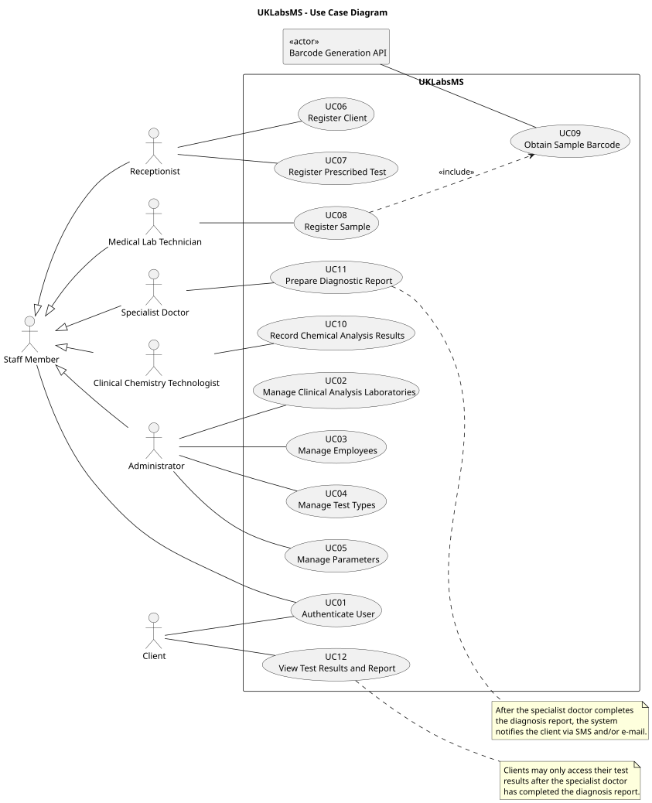

# Use Case Diagram (UCD)

**Note:** The Use Cases identified during Sprint 1 are
preliminary and were inferred from the Project Assignment.
They may be refined following stakeholder clarification
and the introduction of User Stories in subsequent sprints.

The corresponding User Story identifiers and documentation
links will be added as they become available.

# Use Cases / User Stories

| UC/US | Description |
|:------|:------------|
| UC01 | Authenticate User |
| UC02 | Manage Clinical Analysis Laboratories |
| UC03 | Manage Employees |
| UC04 | Manage Test Types |
| UC05 | Manage Parameters |
| UC06 | Register Client |
| UC07 | Register Prescribed Test |
| UC08 | Register Sample |
| UC09 | Obtain Sample Barcode |
| UC10 | Record Chemical Analysis Results |
| UC11 | Prepare Diagnostic Report |
| UC12 | View Test Results and Report |
