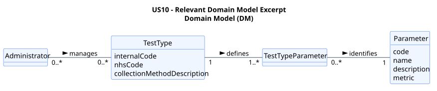
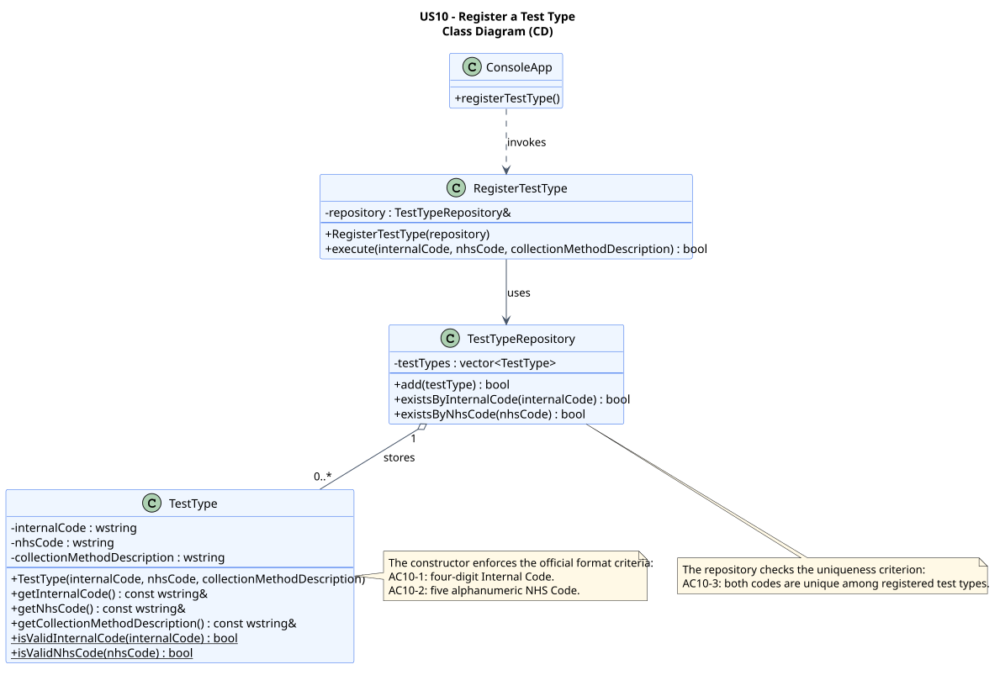

# US 10 - Register a Test Type

## 1. Requirements Engineering

### 1.1. User Story Description

As Administrator, I want to register a test type.

### 1.2. Customer Specifications and Clarifications

**From the specifications document:**

> Catalogue definition of a test characterized by an internal code, NHS code, and sample collection method description.

**From the client clarifications:**

> **Question:** Besides the identification codes specified in the requirements (Internal Code, NHS Code, and Parameter Code), should these entities have any additional descriptive attributes, such as a "Name" or "Description"? If so, are there any specific character limits defined for these new fields?
>
> **Answer:** The attributes for Test Type and Parameter are defined in the Project Assignment from the beginning. No additional acceptance criteria are defined for these attributes, beyond those already specified in the requirements.

> **Question:** According to AC10-3, the NHS Code must be unique across all registered test types. In "Questions regarding US11" (2 Nov 2026) you clarified that the parameter code is not case-sensitive. Does the same apply to the NHS Code? For example, if a test type with NHS Code "AB123" is already registered, should a new test type with "ab123" be rejected as a duplicate?
>
> **Answer:** The NHS Code is not case-sensitive. "AB123" and "ab123" are considered the same code, and registering a new test type with either representation must be rejected if the other is already registered.

### 1.3. Acceptance Criteria

**Official Acceptance Criteria**

- **AC10-1:** The Internal Code must consist of exactly four digits.
- **AC10-2:** The NHS Code must consist of exactly five alphanumeric characters.
- **AC10-3:** The Internal Code and NHS Code must each be unique across all registered Test Types. NHS Code uniqueness is case-insensitive, as clarified by the client.

**Additional Acceptance Criteria - Team Proposals**

- **AC10-4:** When registration succeeds, the system stores the submitted Internal Code, NHS Code, and collection-method description.
- **AC10-5:** When both codes satisfy their format requirements and are unique, the system registers the Test Type.
- **AC10-6:** When the Internal Code does not contain exactly four digits, the system rejects the registration and does not add a Test Type.
- **AC10-7:** When the NHS Code does not contain exactly five alphanumeric characters, the system rejects the registration and does not add a Test Type.
- **AC10-8:** When the Internal Code is already registered, the system rejects the registration and does not add a Test Type.
- **AC10-9:** When the NHS Code is already registered, ignoring letter case, the system rejects the registration and does not add a Test Type.
- **AC10-10:** When registration succeeds, the system informs the Administrator.
- **AC10-11:** When registration fails, the system informs the Administrator.

### 1.4. Found out Dependencies

- No dependencies were found.

### 1.5. Input and Output Data

**Input Data:**

- Typed data:
  - Internal Code
  - NHS Code
  - Collection-method description

- Selected data:
  - n/a

**Output Data:**

- (In)success of the operation

### 1.6. System Sequence Diagram (SSD)

### 1.7. Other Relevant Remarks

- n/a

### 1.8. Main Success Scenario

1. The Administrator asks to register a Test Type.
2. The system requests the Internal Code, NHS Code, and collection-method description.
3. The Administrator provides the requested data.
4. The system verifies that the Internal Code contains exactly four digits.
5. The system verifies that the NHS Code contains exactly five alphanumeric characters.
6. The system verifies that neither code is already registered, comparing NHS Codes without regard to letter case.
7. The system registers the Test Type with the provided data.
8. The system informs the Administrator that registration succeeded.

### 1.9. Alternative Scenarios

**Alternative 1 - Invalid Internal Code**

If the Internal Code is empty, contains fewer or more than four characters, or contains a non-digit, the system rejects registration and informs the Administrator.

**Alternative 2 - Invalid NHS Code**

If the NHS Code is empty, contains fewer or more than five characters, or contains a non-alphanumeric character, the system rejects registration and informs the Administrator.

**Alternative 3 - Duplicate Internal Code**

If the Internal Code is already registered, the system rejects registration and informs the Administrator.

**Alternative 4 - Duplicate NHS Code**

If the NHS Code is already registered, ignoring letter case, the system rejects registration and informs the Administrator.

### 1.10. Requirements Traceability

| Acceptance Criteria | Scenario | Verification |
|:---|:---|:---|
| AC10-1 - Internal Code contains exactly four digits. | Main Success Scenario; Alternative 1 | Unit tests for valid and invalid Internal Codes |
| AC10-2 - NHS Code contains exactly five alphanumeric characters. | Main Success Scenario; Alternative 2 | Unit tests for valid and invalid NHS Codes |
| AC10-3 - Both codes are unique; NHS Code comparison is case-insensitive. | Main Success Scenario; Alternatives 3 and 4 | Unit tests for duplicate Internal Codes and NHS Codes with different letter casing |
| AC10-4 - The submitted Test Type data is stored after successful registration. | Main Success Scenario | Registration and stored-attribute unit tests |
| AC10-5 - Valid unique codes result in registration. | Main Success Scenario | Registration unit test verifies successful storage |
| AC10-6 - Invalid Internal Code causes rejection. | Alternative 1 | Invalid Internal Code tests verify rejection and unchanged container state |
| AC10-7 - Invalid NHS Code causes rejection. | Alternative 2 | Invalid NHS Code tests verify rejection and unchanged container state |
| AC10-8 - Duplicate Internal Code causes rejection. | Alternative 3 | Duplicate Internal Code test verifies rejection and unchanged container state |
| AC10-9 - Duplicate NHS Code causes rejection regardless of letter case. | Alternative 4 | Case-variant duplicate NHS Code test verifies rejection and unchanged container state |
| AC10-10 - Successful registration is communicated to the Administrator. | Main Success Scenario | Manual ConsoleApp check for successful registration response |
| AC10-11 - Rejected registration is communicated to the Administrator. | Alternatives 1-4 | Manual ConsoleApp checks for invalid-format and duplicate-code responses |

## 2. OO Analysis

### 2.1. Relevant Domain Model Excerpt

### 2.2. Other Remarks

- The excerpt follows the shared project Domain Model. The association between `TestType` and `Parameter` is represented through `TestTypeParameter`.

## 3. Design - User Story Realization

### 3.1. Rationale

| Interaction ID | Question: Which class is responsible for... | Answer | Justification (with patterns) |
|:---|:---|:---|:---|
| Step 1 | ... interacting with the actor? | RegisterTestTypeView | Pure Fabrication: user interaction is not a responsibility of a domain class. |
| Step 2 | ... requesting and temporarily keeping the input data? | RegisterTestTypeView | Information Expert: the view handles the registration interaction and its input. |
|  | ... coordinating the user story? | RegisterTestTypeController | Controller: receives the registration operation from the view and coordinates the domain work. |
|  | ... obtaining the Test Type container? | App | Singleton: provides access to the application-owned TestTypeContainer. |
| Step 3 | ... creating and retaining Test Types? | TestTypeContainer | Creator: the container creates TestType instances and records registered instances. |
|  | ... validating the code formats? | TestType | Information Expert: the domain object owns its code data and validates its own state. |
|  | ... checking whether either code is already used? | TestTypeContainer | Information Expert: the container knows the registered Test Types and can check uniqueness. |
| Step 4 | ... informing the Administrator of the outcome? | RegisterTestTypeView | Information Expert: the view presents the result of the interaction. |

### Systematization

According to the rationale, the conceptual class promoted to a software class is:

- TestType

Other software classes (i.e. Pure Fabrication) identified:

- RegisterTestTypeView
- RegisterTestTypeController
- App
- TestTypeContainer

### 3.2. Sequence Diagram (SD)

### 3.3. Class Diagram (CD)

## 4. Construction (Implementation)

- The current C++ implementation validates code formats in `TestType`, coordinates registration through `RegisterTestTypeController`, and uses `TestTypeContainer` to create, check, and store Test Types. `App` owns the container, while `RegisterTestTypeView` handles console input and output.
- `RegisterTestTypeView` collects the three Test Type attributes and reports success, duplicate-code rejection, or invalid-format errors through the ConsoleApp.
- NHS Code uniqueness is case-insensitive, as required by the client clarification.
- Test Types are retained in memory for the current application session; data is not persisted between executions.

## 5. Tests

The automated tests cover valid and invalid code formats, duplicate Internal Codes, duplicate NHS Codes with different letter casing, successful registration, submitted-attribute retention, and container state after success or rejection. Stream-based view tests verify that successful registration, duplicate codes, and invalid formats are reported to the user.

## 6. Integration and Demo

The US10 registration option is integrated into the ConsoleApp menu. The view and controller are constructed for the registration flow; the controller obtains the application-owned `TestTypeContainer` through `App` when the operation is performed. US10's `TestType`, `TestTypeContainer`, controller, and view names are used consistently across its Core implementation and design diagrams; US11 and US13 retain their own Parameter and Employee classes from the shared Domain Model.

## 7. Open Issues

- Is an empty collection-method description permitted?
- Must Test Type registration establish at least one `TestTypeParameter` association at that time, or is that association established through a separate operation?

## 8. Conclusion

US10 - Register a Test Type is documented through requirements engineering, object-oriented analysis, and design, with a C++ registration flow using a Test Type entity, an in-memory container, a controller, and a view.

The requirements section records the three official acceptance criteria and the two US10 clarifications answered in the forum. The NHS Code uniqueness rule reflects the clarification that letter case does not distinguish codes.

The alternative scenarios describe failures to satisfy the official code-format and uniqueness criteria. The SSD presents only the successful interaction between the Administrator and the system.

The shared Domain Model and US10 diagrams document the relevant registration design artifacts.

Automated tests cover code validation, duplicate detection, and registration behavior. The ConsoleApp flow demonstrates registration using the in-memory container.

Sprint 2 focuses on requirements engineering, analysis, and design. Unresolved questions about collection-method descriptions and parameter associations are recorded under Open Issues.

## 9. References

- Project Assignment
- Sprint 2
- Glossary
- Domain Model
