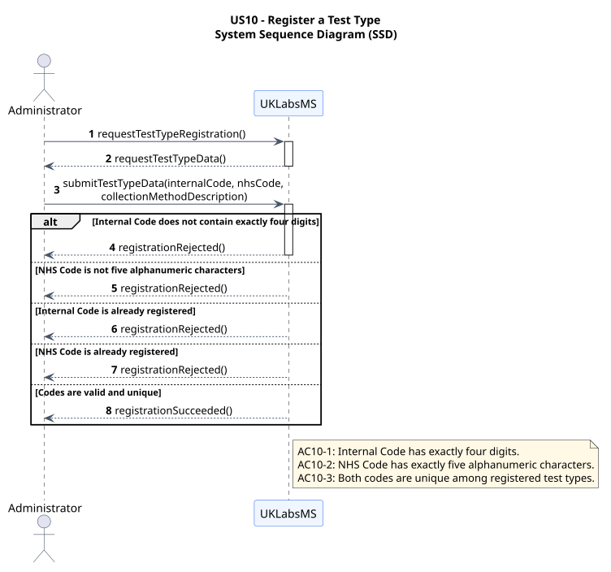
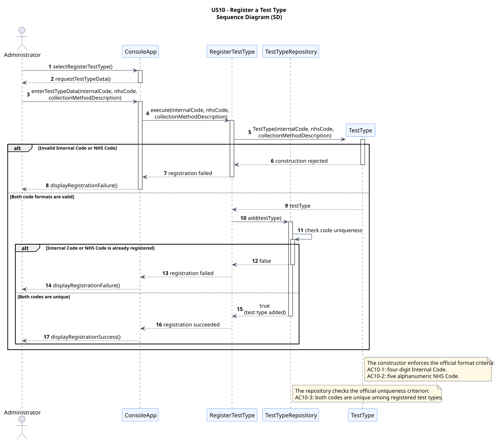

# US10 — Register a Test Type

**Project:** UK Labs Management System (UKLabsMS)\
**Course:** LETI-ESOFT 2026/2027\
**Team:** B6\
**Sprint:** 2
**Priority:** High

## 1. User Story

**US10:** As Administrator, I want to register a test type.

## 2. Description

This user story concerns maintaining the UKLabsMS catalogue of test types. A `TestType` defines a kind of test; it is distinct from a `RegisteredTest`, which records a particular test for a client. Each test type has an Internal Code, an NHS Code, and a description identifying the sample collection method. That description records how the sample is collected; no additional format or length rule is defined for it.

### 2.1 Domain Model Context

The project Domain Model relates `TestType` to `Parameter` through the intermediary class `TestTypeParameter`. This preserves the many-to-many relationship in the project model; US10 does not create or alter that association.

| Class               | Role in the project domain                                                               |
|:--------------------|:-----------------------------------------------------------------------------------------|
| `Administrator`     | Manages core project information, including test types.                                  |
| `TestType`          | Describes a test type by its Internal Code, NHS Code, and collection-method description. |
| `TestTypeParameter` | Represents the association between a test type and a parameter.                          |
| `Parameter`         | Describes a parameter measured by a test type.                                           |

The diagram retains the global Domain Model multiplicities: an Administrator can manage zero or more test types and a test type can be managed by zero or more administrators; each test type is associated with one or more `TestTypeParameter` instances, and each `TestTypeParameter` identifies exactly one Parameter.

## 3. Actors

**Primary actor:** Administrator.

**Supporting actors:** None identified.

## 4. Preconditions

- **PRE10-01:** The Administrator is authenticated in UKLabsMS. Authentication may be simulated for the prototype.
- **PRE10-02:** UKLabsMS is available to accept the registration request.

## 5. Acceptance Criteria

### 5.1 Official Acceptance Criteria

- **AC10-1:** The Internal Code must consist of exactly four digits.
- **AC10-2:** The NHS Code must consist of exactly five alphanumeric characters.
- **AC10-3:** The Internal Code and NHS Code must each be unique across all registered test types.

### 5.2 Additional Acceptance Criteria — Team Proposals

These proposals make the successful result, failure behavior, and feedback of the registration operation testable. They do not add domain attributes or code-format rules.

- **AC10-4:** After successful registration, the registered test type contains the Internal Code, NHS Code, and collection-method description submitted by the Administrator.
- **AC10-5:** If both codes satisfy their format requirements and are unique, the system adds the test type to the registered test types.
- **AC10-6:** If the Internal Code does not contain exactly four digits, the system rejects the registration and leaves the registered test types unchanged.
- **AC10-7:** If the NHS Code is not exactly five alphanumeric characters, the system rejects the registration and leaves the registered test types unchanged.
- **AC10-8:** If the Internal Code is already registered, the system rejects the registration and leaves the registered test types unchanged.
- **AC10-9:** If the NHS Code is already registered, the system rejects the registration and leaves the registered test types unchanged.
- **AC10-10:** After successful registration, the system informs the Administrator that it succeeded.
- **AC10-11:** After rejection, the system informs the Administrator that registration failed.

## 6. Main Success Scenario

1. The Administrator requests to register a test type.
2. UKLabsMS requests the test-type data.
3. The Administrator submits the Internal Code, NHS Code, and collection-method description.
4. UKLabsMS verifies that the Internal Code has exactly four digits.
5. UKLabsMS verifies that the NHS Code has exactly five alphanumeric characters.
6. UKLabsMS verifies that neither code is used by another registered test type.
7. UKLabsMS registers the test type with the submitted attributes.
8. UKLabsMS informs the Administrator that registration succeeded.

## 7. Alternative and Exception Scenarios

### 7.1 Invalid Internal Code

If the Internal Code is empty, contains fewer or more than four characters, or contains a non-digit, UKLabsMS rejects the registration, leaves the registered test types unchanged, and informs the Administrator.

### 7.2 Invalid NHS Code

If the NHS Code is empty, contains fewer or more than five characters, or contains a non-alphanumeric character, UKLabsMS rejects the registration, leaves the registered test types unchanged, and informs the Administrator.

### 7.3 Duplicate Internal Code

If another registered test type already uses the Internal Code, UKLabsMS rejects the registration, leaves the registered test types unchanged, and informs the Administrator.

### 7.4 Duplicate NHS Code

If another registered test type already uses the NHS Code, UKLabsMS rejects the registration, leaves the registered test types unchanged, and informs the Administrator.

The scenarios above cover each official failure condition separately. If more than one condition fails in the same request, the registration is rejected and the registered collection remains unchanged. No numeric range or reference-value validation applies to the attributes defined for a test type.

## 8. Postconditions

### Success Postcondition

The new test type is among the registered test types with the three submitted attributes. Its Internal Code and NHS Code are unique in the registered set.

### Failure Postcondition

The submitted test type is not added to the registered test types, and the Administrator is informed that registration was rejected.

## 9. Business Rules

- **BR10-1:** An Internal Code consists of exactly four digits. *(AC10-1)*
- **BR10-2:** An NHS Code consists of exactly five alphanumeric characters. *(AC10-2)*
- **BR10-3:** Internal Codes and NHS Codes are each unique across registered test types. *(AC10-3)*
- **BR10-4 (Team Proposal):** The Internal Code is compared with the Internal Code of each registered test type. Registration fails if a matching Internal Code is found. *(AC10-3, AC10-8)*
- **BR10-5 (Team Proposal):** The NHS Code is compared with the NHS Code of each registered test type. Registration fails if a matching NHS Code is found. *(AC10-3, AC10-9)*
- **BR10-6 (Team Proposal):** On successful registration, the TestType stores the submitted Internal Code, NHS Code, and collection-method description. The collection-method description is stored as supplied and has no additional format or length validation. *(AC10-4)*
- **BR10-7 (Team Proposal):** The repository adds one TestType only when the Internal Code and NHS Code are both valid and neither code is already registered. *(AC10-5)*
- **BR10-8 (Team Proposal):** When registration is rejected, the number and attributes of registered test types remain unchanged. *(AC10-6–AC10-9)*

## 10. Requirements Traceability

| Acceptance criterion                                                         | Main/alternative scenario  | Diagram representation  | Test case              |
|:-----------------------------------------------------------------------------|:---------------------------|:------------------------|:-----------------------|
| AC10-1 — Internal Code contains exactly four digits                          | Main success; 7.1          | SSD and SD              | TC10-1, TC10-2         |
| AC10-2 — NHS Code contains exactly five alphanumeric characters              | Main success; 7.2          | SSD and SD              | TC10-1, TC10-3         |
| AC10-3 — both codes are unique                                               | Main success; 7.3 and 7.4  | SSD and SD              | TC10-1, TC10-4, TC10-5 |
| AC10-4 — successful registration retains all three submitted attributes      | Main success               | SD and CD               | TC10-1                 |
| AC10-5 — valid, unique data is registered                                    | Main success               | SSD and SD              | TC10-1                 |
| AC10-6 — invalid Internal Code is rejected without changing the collection   | 7.1                        | SSD and SD              | TC10-2                 |
| AC10-7 — invalid NHS Code is rejected without changing the collection        | 7.2                        | SSD and SD              | TC10-3                 |
| AC10-8 — duplicate Internal Code is rejected without changing the collection | 7.3                        | SSD and SD              | TC10-4                 |
| AC10-9 — duplicate NHS Code is rejected without changing the collection      | 7.4                        | SSD and SD              | TC10-5                 |
| AC10-10 — successful outcome is communicated to the Administrator            | Main success               | SSD and SD              | MT10-1                 |
| AC10-11 — rejection is communicated to the Administrator                     | 7.1–7.4                    | SSD and SD              | MT10-2–MT10-5          |

## 11. References

- LETI-ESOFT 2026/2027 — Project Assignment.
- LETI-ESOFT 2026/2027 — Project Sprint 2.
- UKLabsMS Glossary.
- UKLabsMS Domain Model.

## 12. System Sequence Diagram (SSD)

The System Sequence Diagram represents the interaction between the Administrator and UKLabsMS during test-type registration.

UKLabsMS is represented as a black box, focusing on the system events exchanged with the primary actor.

The diagram includes the main success scenario and alternative flows for code-format and code-uniqueness failures.

### 12.1 SSD Description

The Administrator initiates the registration process and provides the test-type information:

- Internal Code
- NHS Code
- Description identifying the sample collection method

UKLabsMS checks the Internal Code format, the NHS Code format, and the uniqueness of both codes among registered test types.

If all three official acceptance criteria are satisfied, UKLabsMS registers the test type and reports success. If a format or uniqueness check fails, UKLabsMS rejects the registration and reports the failure.

## 13. Class Diagram (CD)

The Class Diagram (CD) shows the software classes and relationships used to realize US10. It includes the console interface, the `RegisterTestType` service, the in-memory repository, and the `TestType` domain class. The class responsibilities separate collection of input, registration coordination, code uniqueness, and test-type data and format validation.

- `ConsoleApp` — interacts with the Administrator.
- `RegisterTestType` — coordinates construction and repository registration.
- `TestTypeRepository` — stores test types and checks uniqueness against the registered collection.
- `TestType` — represents a test type and its three defined attributes.

### 13.1 Class Responsibilities

| Class                | Responsibility                                                                                    |
|:---------------------|:--------------------------------------------------------------------------------------------------|
| `ConsoleApp`         | Collects input and presents the registration result.                                              |
| `RegisterTestType`   | Creates a validated `TestType` and requests its registration.                                     |
| `TestTypeRepository` | Stores test types and checks code uniqueness against the registered collection.                   |
| `TestType`           | Holds the test-type attributes and enforces the two code-format requirements during construction. |

### 13.2 Design Considerations

The design separates user interaction, registration coordination, test-type data, and collection management. `RegisterTestType` creates the domain object and delegates uniqueness enforcement and storage to `TestTypeRepository`. The repository knows its registered test types and is responsible for uniqueness checking. This supports High Cohesion and Low Coupling and applies Information Expert responsibilities. The class diagram uses one relationship per pair of classes: dependencies for use/coordination and aggregation for the repository’s collection of test types.

The in-memory collection is consistent with the Sprint 2 allowance for in-memory persistence.

## 14. Sequence Diagram (SD)

The Sequence Diagram (SD) expands the system-level behavior shown in the SSD into interactions among the objects in the implementation. It illustrates how the `ConsoleApp`, `RegisterTestType`, `TestTypeRepository`, and `TestType` collaborate during registration, including the validation and storage responsibilities.

### 14.1 Main Success Scenario

1. The Administrator selects the registration option in the `ConsoleApp`.
2. The `ConsoleApp` requests the test-type data.
3. The Administrator enters the Internal Code, NHS Code, and collection-method description.
4. The `ConsoleApp` invokes `RegisterTestType::execute()`.
5. The service creates the `TestType`; construction enforces the two code-format requirements.
6. The service asks `TestTypeRepository` to add the test type.
7. The repository checks both codes against registered test types.
8. If both codes are unique, the repository stores the test type and returns success.
9. The service returns the result to the `ConsoleApp`, which informs the Administrator.

### 14.2 Alternative Scenarios

**Invalid Internal Code:** The service creates a `TestType` with the submitted attributes. If the Internal Code is empty, contains fewer or more than four characters, or contains a non-digit, construction throws `std::invalid_argument`. The service does not add a test type to the repository, and the `ConsoleApp` displays the validation message.

**Invalid NHS Code:** If the NHS Code is empty, contains fewer or more than five characters, or contains a non-alphanumeric character, `TestType` construction throws `std::invalid_argument`. The service does not add a test type to the repository, and the `ConsoleApp` displays the validation message.

**Duplicate Internal Code:** After a valid `TestType` has been created, the repository finds that its Internal Code is already used by a registered test type. It does not add the test type, returns `false`, and the `ConsoleApp` informs the Administrator.

**Duplicate NHS Code:** If the repository finds that the NHS Code is already used, it likewise does not add the test type, returns `false`, and the `ConsoleApp` informs the Administrator.

In each alternative, the registered test-type collection remains unchanged.

### 14.3 Design Notes

The `TestType` constructor enforces the Internal Code and NHS Code formats. `TestTypeRepository::add()` checks both codes and stores the object only if neither has been registered. Invalid format errors are reported through `std::invalid_argument`; duplicate codes produce a `false` result. The ConsoleApp displays either failure.

## 15. Implementation and Testing

### 15.1 Implementation

US10 is implemented in C++ using the project's existing domain, repository, service, console, and Google Test patterns.

**Domain entity**

- `Core/headers/domain/testType/TestType.h`
- `Core/sources/domain/testType/TestType.cpp`

**Repository**

- `Core/headers/domain/testType/TestTypeRepository.h`
- `Core/sources/domain/testType/TestTypeRepository.cpp`

**Registration service**

- `Core/headers/domain/testType/RegisterTestType.h`
- `Core/sources/domain/testType/RegisterTestType.cpp`

**Console application**

- `ConsoleApp/ConsoleApp.cpp`

**Unit tests**

- `CoreTests/domain/testType/TestTypeTests.cpp`

### 15.2 Automated Testing

The US10 unit tests use Google Test. All 16 US10 tests pass; the complete CoreTests executable passes all 61 tests. Coverage includes attribute storage, valid and invalid Internal Codes, valid and invalid NHS Codes, constructor validation, duplicate Internal Code and NHS Code rejection, submitted-attribute retention, and ensuring failed registrations do not change the repository.

| Test case  | Scenario                                                                                  | Expected result                                                                                     | Acceptance criteria   |
|:-----------|:------------------------------------------------------------------------------------------|:----------------------------------------------------------------------------------------------------|:----------------------|
| TC10-1     | Register a test type with valid, unused codes                                             | Registration succeeds and the repository contains one test type with all three submitted attributes | AC10-1–AC10-5         |
| TC10-2     | Internal Code is empty, has a length other than four, or contains a non-digit             | Construction is rejected; repository remains unchanged                                              | AC10-1, AC10-6        |
| TC10-3     | NHS Code is empty, has a length other than five, or contains a non-alphanumeric character | Construction is rejected; repository remains unchanged                                              | AC10-2, AC10-7        |
| TC10-4     | Internal Code duplicates a registered test type                                           | Registration returns failure; repository remains unchanged                                          | AC10-3, AC10-8        |
| TC10-5     | NHS Code duplicates a registered test type                                                | Registration returns failure; repository remains unchanged                                          | AC10-3, AC10-9        |

### 15.3 Manual Testing

The ConsoleApp registration flow was exercised with the following scenarios:

| Test case   | Scenario                                                   | Observed result                                                |
|:------------|:-----------------------------------------------------------|:---------------------------------------------------------------|
| MT10-1      | Register valid data with unused codes                      | The ConsoleApp displayed the successful-registration message.  |
| MT10-2      | Reuse a registered Internal Code                           | The ConsoleApp displayed the duplicate-code rejection message. |
| MT10-3      | Reuse a registered NHS Code                                | The ConsoleApp displayed the duplicate-code rejection message. |
| MT10-4      | Submit an Internal Code containing a non-digit             | The ConsoleApp displayed the Internal Code validation message. |
| MT10-5      | Submit an NHS Code containing a non-alphanumeric character | The ConsoleApp displayed the NHS Code validation message.      |

### 15.4 Data Storage

The `TestTypeRepository` stores registered test types in an in-memory collection. The data remains available during the application execution and is not persisted between executions.

### 15.5 Authentication

The Administrator is the primary actor. Authentication is treated as a precondition and may be simulated for the prototype; this document does not add authentication behavior to US10.

## 16. Conclusion

US10 — Register a Test Type was implemented in C++ using a domain entity, repository, registration service and console interface.

The implementation addresses the three official acceptance criteria:

**AC10-1:** The Internal Code must contain exactly four digits.

**AC10-2:** The NHS Code must contain exactly five alphanumeric characters.

**AC10-3:** The Internal Code and NHS Code must each be unique across registered test types.

The implementation also stores the three defined test-type attributes and rejects invalid code formats or duplicate codes without changing the registered test types.

The functionality was verified using automated tests and manual console testing.

Three UML diagrams were created to document the registration process and implementation:

- System Sequence Diagram (SSD).
- Class Diagram (CD).
- Sequence Diagram (SD).

The implementation is functional for the tested scenarios. Registered test types are stored in memory for the duration of the application.
