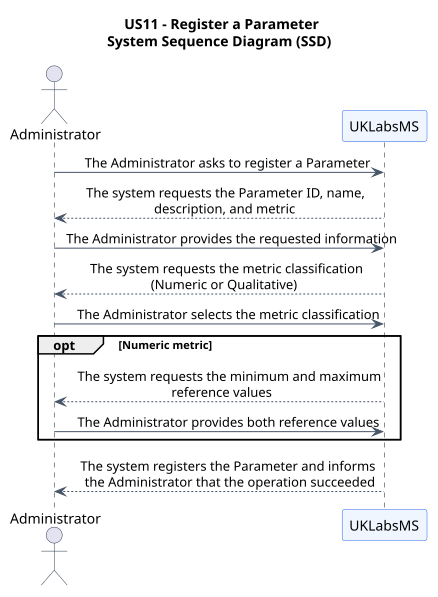
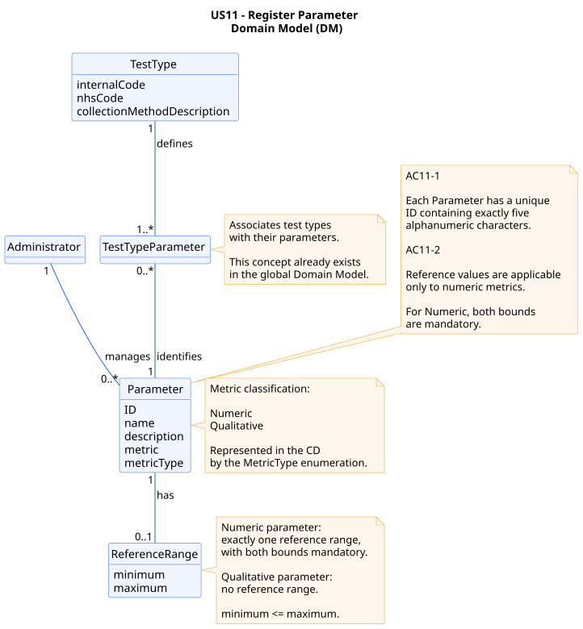
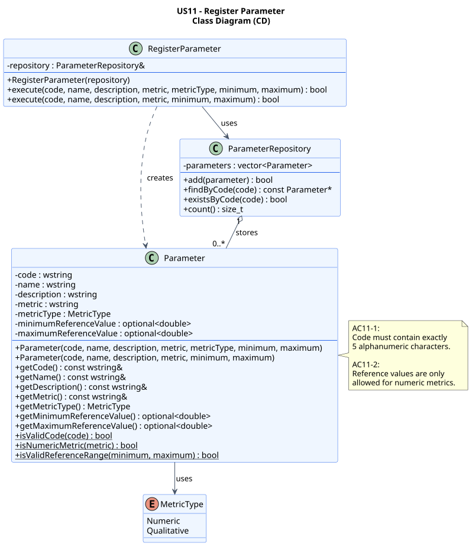

# US 11 - Register a Parameter

## 1. Requirements Engineering

### 1.1. User Story Description

As Administrator, I want to register a parameter.

### 1.2. Customer Specifications and Clarifications

**From the specifications document:**

> A Parameter is characterized by an ID, name, description, metric, and reference values when applicable.

**From the client clarifications:**

> **Question:** Besides the identification codes specified in the requirements (Internal Code, NHS Code, and Parameter Code), should these entities have any additional descriptive attributes, such as a "Name" or "Description"? If so, are there any specific character limits defined for these new fields?
>
> **Answer:** The attributes for Test Type and Parameter are defined in the Project Assignment from the beginning. No additional acceptance criteria are defined for these attributes, beyond those already specified in the requirements.

### 1.3. Acceptance Criteria

**Official Acceptance Criteria**

- **AC11-1:** The Parameter ID must consist of exactly five alphanumeric characters and must be unique across all registered parameters.
- **AC11-2:** Reference values are applicable to numeric metrics only.

**Additional Acceptance Criteria - Team Proposals**

- **AC11-3:** The Administrator provides the Parameter ID, name, description, and metric.
- **AC11-4:** When the Parameter ID does not contain exactly five characters, the system rejects the registration.
- **AC11-5:** When the Parameter ID contains non-alphanumeric characters, the system rejects the registration.
- **AC11-6:** When the Parameter ID is already registered, the system rejects the registration.
- **AC11-7:** When reference values are supplied for a qualitative metric, the system rejects the registration.
- **AC11-8:** Numeric parameters require both minimum and maximum reference values, and the minimum must not exceed the maximum.
- **AC11-9:** When registration succeeds, the system stores the Parameter and informs the Administrator.
- **AC11-10:** When registration fails, the system informs the Administrator without storing an invalid Parameter.
- **AC11-11:** The Administrator selects whether the metric classification is Numeric or Qualitative.

### 1.4. Found out Dependencies

- No dependencies were found for registering a Parameter.

### 1.5. Input and Output Data

**Input Data:**

- Typed data:
   - Parameter ID
   - Name
   - Description
   - Metric
   - Minimum reference value (mandatory for Numeric)
   - Maximum reference value (mandatory for Numeric)

- Selected data:
   - Metric classification:
      - Numeric
      - Qualitative

**Output Data:**

- (In)success of the operation.

### 1.6. System Sequence Diagram (SSD)

### 1.7. Other Relevant Remarks

- The Administrator explicitly selects the metric classification.
- Numeric parameters require both minimum and maximum reference values.
- Qualitative parameters do not have numeric reference values.
- The minimum reference value must not exceed the maximum reference value.

### 1.8. Main Success Scenario

1. The Administrator asks to register a Parameter.
2. The system requests the Parameter ID, name, description, and metric.
3. The Administrator provides the requested data.
4. The system requests the metric classification.
5. The Administrator selects Numeric or Qualitative.
6. If Numeric is selected, the system requests both minimum and maximum reference values.
7. The Administrator provides both reference values for a Numeric parameter.
8. The system verifies that the Parameter ID contains exactly five alphanumeric characters.
9. The system verifies that the Parameter ID is unique.
10. The system validates the mandatory attributes and reference values.
11. The system registers the Parameter.
12. The system informs the Administrator that registration succeeded.

### 1.9. Alternative Scenarios

**Alternative 1 - Invalid Parameter ID Length**

If the Parameter ID does not contain exactly five characters, the system rejects registration and informs the Administrator.

**Alternative 2 - Invalid Parameter ID Characters**

If the Parameter ID contains non-alphanumeric characters, the system rejects registration and informs the Administrator.

**Alternative 3 - Duplicate Parameter ID**

If the Parameter ID is already registered, the system rejects registration and informs the Administrator.

**Alternative 4 - Missing Mandatory Attributes**

If the name, description, or metric is empty, the system rejects registration and informs the Administrator.

**Alternative 5 - Reference Values for Qualitative Metric**

If numeric reference values are supplied for a Qualitative parameter, the system rejects registration and informs the Administrator.

**Alternative 6 - Invalid Reference Range**

If the minimum reference value exceeds the maximum reference value, the system rejects registration and informs the Administrator.

**Alternative 7 - Missing Reference Values for Numeric Metric**

If a Numeric parameter does not include both minimum and maximum reference values, the system rejects registration and informs the Administrator.

**Alternative 8 - Invalid Metric Classification**

If the Administrator selects an invalid metric classification, the system rejects the selection and informs the Administrator.

### 1.10. Requirements Traceability

| Acceptance Criteria | Scenario | Verification |
|:---|:---|:---|
| AC11-1 - Parameter ID contains exactly five alphanumeric characters and is unique. | Main Success Scenario; Alternatives 1-3 | Parameter ID validation and repository unit tests |
| AC11-2 - Reference values are applicable to numeric metrics only. | Main Success Scenario; Alternative 5 | Numeric and Qualitative metric validation tests |
| AC11-3 - Required Parameter data is provided. | Main Success Scenario; Alternative 4 | Mandatory field validation tests |
| AC11-4 - Invalid Parameter ID length causes rejection. | Alternative 1 | Unit tests for IDs with fewer or more than five characters |
| AC11-5 - Non-alphanumeric Parameter IDs cause rejection. | Alternative 2 | Unit tests for invalid ID characters |
| AC11-6 - Duplicate Parameter IDs cause rejection. | Alternative 3 | Repository and registration service duplicate ID tests |
| AC11-7 - Qualitative metrics cannot contain numeric reference values. | Alternative 5 | Qualitative metric validation tests |
| AC11-8 - Numeric parameters require valid minimum and maximum values. | Main Success Scenario; Alternatives 6 and 7 | Reference range and mandatory numeric values tests |
| AC11-9 - Successful registration stores the Parameter and informs the Administrator. | Main Success Scenario | Registration tests and manual ConsoleApp check |
| AC11-10 - Failed registration does not store an invalid Parameter. | Alternatives 1-8 | Validation tests and repository count verification |
| AC11-11 - Metric classification is explicitly selected. | Main Success Scenario; Alternative 8 | Explicit MetricType tests and ConsoleApp check |

## 2. OO Analysis

### 2.1. Relevant Domain Model Excerpt

### 2.2. Other Remarks

- The Domain Model represents the Parameter concept and its relevant relationships.
- Numeric Parameters require minimum and maximum reference values.
- Qualitative Parameters do not have numeric reference values.
- The relationship between TestType and Parameter is represented through TestTypeParameter in the shared Domain Model.

## 3. Design - User Story Realization

### 3.1. Rationale

| Interaction ID | Question: Which class is responsible for... | Answer | Justification (with patterns) |
|:---|:---|:---|:---|
| Step 1 | ... interacting with the actor? | ConsoleApp | Pure Fabrication: console interaction is not a responsibility of the domain entity. |
| Step 2 | ... requesting and temporarily keeping the input data? | ConsoleApp | Information Expert: the console interface collects the registration input. |
|  | ... coordinating the registration operation? | RegisterParameter | Controller: receives the registration request and coordinates the domain operations. |
| Step 3 | ... creating and validating a Parameter? | Parameter | Information Expert: the Parameter entity validates its own attributes and business rules. |
|  | ... checking whether the Parameter ID already exists? | ParameterRepository | Information Expert: the repository knows the registered Parameters. |
|  | ... storing a valid Parameter? | ParameterRepository | Information Expert: the repository manages the Parameter collection. |
| Step 4 | ... informing the Administrator of the registration result? | ConsoleApp | Information Expert: the console interface presents the operation result. |

### Systematization

According to the rationale, the conceptual class promoted to a software class is:

- Parameter

Other software classes (i.e. Pure Fabrication) identified:

- ConsoleApp
- RegisterParameter
- ParameterRepository

The MetricType enumeration identifies whether a Parameter has a Numeric or Qualitative metric.

### 3.2. Sequence Diagram (SD)

### 3.3. Class Diagram (CD)

## 4. Construction (Implementation)

- The current C++ implementation validates the Parameter ID and mandatory attributes in `Parameter`.
- `Parameter::isValidID()` verifies that the ID contains exactly five alphanumeric characters.
- `RegisterParameter` coordinates the registration operation.
- `ParameterRepository` checks ID uniqueness and stores registered Parameters.
- `ConsoleApp` collects the registration data and displays success or failure messages.
- The Administrator explicitly selects `MetricType::Numeric` or `MetricType::Qualitative`.
- Numeric Parameters require both minimum and maximum reference values.
- Qualitative Parameters cannot contain numeric reference values.
- When both reference values are provided, the minimum must not exceed the maximum.
- Parameters are retained in memory during the current application session; data is not persisted between executions.

## 5. Tests

The automated tests use Google Test to verify Parameter registration and validation.

The tests cover:

- Valid five-character alphanumeric IDs.
- Invalid ID lengths.
- Non-alphanumeric ID characters.
- Empty IDs.
- Mandatory fields.
- Valid and invalid reference ranges.
- Numeric Parameters with valid reference values.
- Qualitative Parameters without numeric reference values.
- Rejection of numeric reference values for Qualitative Parameters.
- Rejection of Numeric Parameters without a minimum reference value.
- Rejection of Numeric Parameters without a maximum reference value.
- Rejection of Numeric Parameters without both reference values.
- Successful Parameter registration.
- Duplicate Parameter ID rejection.
- Repository operations.
- Registration using explicit MetricType classification.
- Rejection of invalid registrations without storing the Parameter.

The updated Google Test suite was executed successfully after the migration from `Code` to `ID`.

All tests passed.

## 6. Integration and Demo

The US11 registration option is integrated into the ConsoleApp menu.

The Administrator selects:

`2 - Register Parameter (US11)`

The application requests:

1. Parameter ID.
2. Name.
3. Description.
4. Metric.
5. Metric classification.

For Numeric metrics, the application additionally requests the minimum and maximum reference values.

For Qualitative metrics, no numeric reference values are requested.

After validation, the application registers the Parameter or displays an appropriate error message.

The registration flow uses the `Parameter`, `RegisterParameter`, and `ParameterRepository` classes.

US11 is integrated alongside US10 and US13 without modifying their respective domain logic.

## 7. Open Issues

- Should Parameter ID uniqueness be case-insensitive? The current implementation compares IDs using case-sensitive string equality.
- Should the registration process allow the Administrator to retry invalid input without restarting the operation?

## 8. Conclusion

US11 - Register a Parameter is documented through requirements engineering, object-oriented analysis, and design, with a C++ registration flow using a Parameter entity, an in-memory repository, a registration service, and a console interface.

The requirements section records the two official acceptance criteria and the additional rules considered during development.

AC11-1 requires a unique Parameter ID containing exactly five alphanumeric characters.

AC11-2 establishes that reference values are applicable to numeric metrics only.

The professor additionally confirmed that Numeric Parameters must include both minimum and maximum reference values.

These rules are enforced by the current implementation and verified through automated tests.

The alternative scenarios describe invalid Parameter IDs, duplicate IDs, missing mandatory attributes, invalid metric classifications, and invalid reference values.

The SSD presents the successful interaction between the Administrator and the system, including an optional interaction fragment (`opt`) for the reference values required when the metric classification is Numeric.

The Domain Model, Sequence Diagram, and Class Diagram document the relevant domain concepts and registration design.

Automated tests verify Parameter validation, ID uniqueness, reference values, repository behavior, and registration operations.

The ConsoleApp demonstrates the registration process using in-memory storage.

Sprint 2 focuses on requirements engineering, object-oriented analysis, and design, with the implemented prototype supporting the documented registration flow.

## 9. References

- Project Assignment
- Sprint 2
- Glossary
- Domain Model