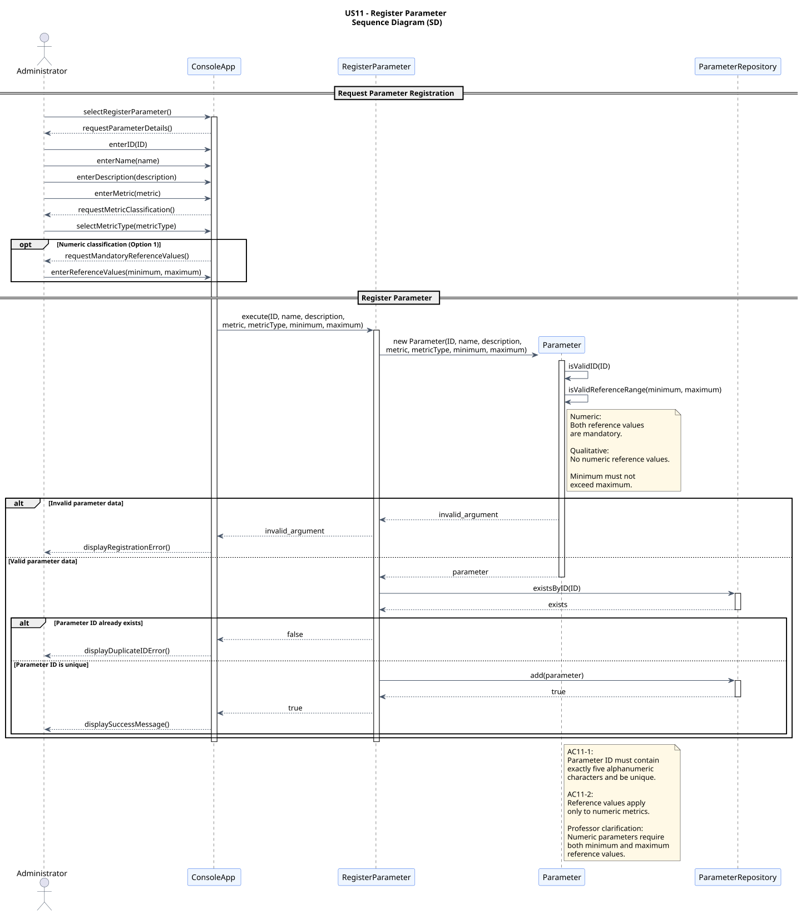

# US11 — Register Parameter

**Project:** UK Labs Management System (UKLabsMS)  
**Course:** LETI-ESOFT 2026/2027  
**Team:** B6  
**Sprint:** 2  
**Priority:** High

## 1. User Story

**US11:** As Administrator, I want to register a parameter.

## 2. Description

This user story allows an Administrator to register a new clinical analysis parameter in the UKLabsMS.

Each parameter is characterized by a unique code, a name, a description, a metric, a metric classification (`Numeric` or `Qualitative`), and reference values (minimum and maximum), which are mandatory for numeric metrics and not applicable to qualitative metrics.

The system must validate the information before registering the parameter, ensuring consistency with the business rules.

The metric classification is explicitly selected during registration. This allows the system to distinguish numeric and qualitative metrics without relying on a predefined list of measurement units.

## 3. Actors

**Primary Actor:** Administrator

**Supporting Actors:** None identified.

## 4. Preconditions

- PRE11-01: The Administrator is authenticated in the system. Authentication may be simulated during the prototype stage.
- PRE11-02: The system is available and ready to accept parameter registrations.

## 5. Acceptance Criteria

### 5.1 Official Acceptance Criteria

**AC11-1:** The Code must consist of exactly five alphanumeric characters and must be unique across all registered parameters.

**AC11-2:** Reference values are applicable to numeric metrics only.

### 5.2 Additional Acceptance Criteria — Team Proposals

The following criteria clarify the expected system behavior and should be validated with the stakeholder unless otherwise indicated.

**AC11-3:** The Administrator must provide a code, name, description, and metric when registering a parameter.

**AC11-4:** If the provided code contains fewer or more than five characters, the system must reject the registration.

**AC11-5:** If the provided code contains non-alphanumeric characters, the system must reject the registration.

**AC11-6:** If another parameter with the same code already exists, the system must reject the registration.

**AC11-7:** If reference values are provided for a non-numeric metric, the system must reject the registration.

**AC11-8:** For numeric metrics, both minimum and maximum reference values are mandatory, and the minimum must not exceed the maximum.

**AC11-9:** When registration succeeds, the system must store the parameter and display a confirmation message.

**AC11-10:** When registration fails, the system must display an appropriate error message without registering the invalid parameter.

**AC11-11 (Confirmed with the professor):** Every numeric parameter must include both minimum and maximum reference values. Qualitative parameters must not include numeric reference values.

This clarification supplements the wording of official AC11-2.

## 6. Main Success Scenario

1. The Administrator selects the option to register a parameter.
2. The system requests the parameter information.
3. The Administrator enters the code, name, description, and metric.
4. The system requests the metric classification:
    - 1 — Numeric.
    - 2 — Qualitative.
5. The Administrator selects the classification.
6. If the classification is `Numeric`, the system requests both minimum and maximum reference values.
7. The Administrator provides both values for a numeric metric. For `Qualitative`, no numeric reference values are entered.
8. The system validates the information.
9. The system verifies that the parameter code is unique.
10. The system registers the parameter.
11. The system displays a confirmation message.

## 7. Alternative and Exception Scenarios

### 7.1 Invalid Code Length

If the code does not contain exactly five characters:

1. The system rejects the registration.
2. The system informs the Administrator that the code must contain exactly five alphanumeric characters.
3. No parameter is registered.

### 7.2 Invalid Code Characters

If the code contains non-alphanumeric characters:

1. The system rejects the registration.
2. The system displays an appropriate validation message.
3. No parameter is registered.

### 7.3 Duplicate Code

If the provided code already exists:

1. The system rejects the registration.
2. The system informs the Administrator that the code is already registered.
3. No duplicate parameter is created.

### 7.4 Invalid Reference Values

If reference values are provided for a qualitative metric:

1. The system rejects the registration.
2. The system explains that numeric reference values are only applicable to numeric metrics.
3. No parameter is registered.

### 7.5 Invalid Reference Range

If the minimum reference value exceeds the maximum:

1. The system rejects the registration.
2. The system displays an appropriate error message.
3. No parameter is registered.

### 7.6 Invalid Metric Classification

If the Administrator selects an invalid metric classification:

1. The system rejects the selected option.
2. The system displays an appropriate error message.
3. No parameter is registered.

### 7.7 Invalid Numeric Input

If the Administrator provides invalid numeric reference values:

1. The system rejects the input.
2. The system displays an appropriate error message.
3. No parameter is registered.

### 7.8 Missing Reference Values for Numeric Metric

If the classification is `Numeric` but either the minimum or maximum reference value is missing:

1. The system rejects the registration.
2. The system informs the Administrator that both values are mandatory for numeric metrics.
3. No parameter is registered.

## 8. Postconditions

### Success Postcondition

A new parameter is registered and becomes available for subsequent system operations.

### Failure Postcondition

No new parameter is registered, and previously registered parameters remain unchanged.

## 9. Business Rules

**BR11-01:** Each parameter must have a unique code consisting of exactly five alphanumeric characters.

**BR11-02:** Reference values are applicable only to numeric metrics.

**BR11-03 (Proposed):** The minimum reference value must not exceed the maximum reference value.

**BR11-04 (Proposed):** Each parameter must have a metric classification identifying whether its results are numeric or qualitative.

**BR11-05 (Confirmed with the professor):** Numeric parameters require both minimum and maximum reference values; qualitative parameters must not have numeric reference values.

### 9.1 Metric Classification

The system supports two metric classifications:

- **Numeric:** Represents quantitative measurements and requires both minimum and maximum reference values.
- **Qualitative:** Represents non-numeric results and cannot contain numeric reference values.

The classification is represented in the implementation by the `MetricType` enumeration.

During registration, the Administrator selects:

- `1` — Numeric.
- `2` — Qualitative.

The explicit classification allows the registration of numeric parameters using different measurement units without depending on a predefined list of units.

### 9.2 Reference Values

The C++ interface represents minimum and maximum values using `optional<double>`.

This allows reference values to be absent for qualitative metrics while preserving compatibility with existing interfaces.

However, **reference values are not optional for numeric parameters**.

For `Numeric`, the system must receive both minimum and maximum values.

For `Qualitative`, numeric reference values must not be provided.

When both values exist, the minimum must not exceed the maximum.

The mandatory-numeric rule was confirmed by the professor. The C++ implementation and automated tests must be updated to enforce this behavior.

## 10. Requirements Traceability

| Requirement | Acceptance Criteria | Verification |
|:---|:---|:---|
| Unique five-character alphanumeric code | AC11-1, AC11-4, AC11-5, AC11-6 | Unit tests and manual testing |
| Reference values restricted to numeric metrics | AC11-2, AC11-7 | Unit tests and manual testing |
| Required parameter information | AC11-3 | Validation tests |
| Valid reference interval | AC11-8 | Unit tests |
| Successful registration | AC11-9 | Service tests and manual testing |
| Rejection of invalid registrations | AC11-10 | Unit tests and manual testing |
| Explicit metric classification | BR11-04 | Unit tests and manual testing |
| Mandatory bounds for numeric metrics | AC11-8, AC11-11, BR11-05 | New or updated validation tests required |

## 11. Open Issues

- **OI11-01:** Should the explicit `Numeric`/`Qualitative` classification remain the definitive mechanism for identifying metric types?
- **OI11-02:** Are parameter codes case-sensitive when checking uniqueness?
- **OI11-03 (Resolved):** The professor confirmed that numeric parameters must always have both minimum and maximum reference values.
- **OI11-04:** Are empty descriptions permitted?
- **OI11-05:** Should an Administrator be allowed to retry after entering invalid information without restarting the registration process?

## 12. References

- LETI-ESOFT 2026/2027 — Project Assignment.
- LETI-ESOFT 2026/2027 — Project Sprint 2.
- UKLabsMS Glossary.
- UKLabsMS Domain Model.

## 13. System Sequence Diagram (SSD)

The System Sequence Diagram represents the interactions between the Administrator and the UKLabsMS during parameter registration.

The system is represented as a black box, focusing on the messages exchanged between the primary actor and the system.

The SSD focuses on the successful registration flow.

The `opt` fragment represents reference-value entry when the classification is `Numeric`. Within that branch, both values are mandatory.

Validation errors are documented in the alternative scenarios and detailed design.

### 13.1 SSD Description

The Administrator initiates parameter registration and provides:

- Code.
- Name.
- Description.
- Metric.
- Metric classification.

The system requests the metric classification:

- `1` — Numeric.
- `2` — Qualitative.

For a numeric classification, the system requests both minimum and maximum reference values.

For a qualitative classification, no numeric reference values are entered.

The system validates the information and confirms successful registration.

### 13.2 Requirements Traceability

| Acceptance Criterion | SSD Representation |
|:---|:---|
| AC11-1 | Parameter code supplied; validation rule documented separately |
| AC11-2 | Reference values restricted to numeric classification |
| AC11-3 | Required parameter information |
| AC11-4 | Code length rule documented in acceptance criteria |
| AC11-5 | Alphanumeric code rule documented in acceptance criteria |
| AC11-6 | Uniqueness rule documented in acceptance criteria |
| AC11-7 | No reference values for qualitative classification |
| AC11-8 | Mandatory reference bounds for numeric classification |
| AC11-9 | Successful parameter registration |
| AC11-10 | Failure handling documented in alternative scenarios |
| AC11-11 | Mandatory numeric reference values |

## 14. Domain Model (DM)

The Domain Model represents the main business concepts related to registering clinical analysis parameters, independently of the C++ classes, methods and storage mechanisms.

### 14.1 Domain Concepts

| Concept | Business meaning |
|:---|:---|
| Administrator | User responsible for registering and managing clinical analysis parameters. |
| Parameter | Clinical analysis parameter identified by a code, name, description, metric and metric classification. |
| ReferenceRange | Concept containing the minimum and maximum bounds associated with a numeric parameter. |
| TestType | Clinical test category that may involve one or more parameters. |
| TestTypeParameter | Conceptual association between a test type and a parameter. |

### 14.2 Domain Relationships

**Administrator — Parameter**

The Administrator is responsible for registering and managing parameters.

**Parameter — ReferenceRange**

The relationship depends on the metric classification:

- `Numeric`: exactly one reference range containing both minimum and maximum values.
- `Qualitative`: no numeric reference range.

The diagram uses the general multiplicity `0..1`, with the classification-dependent constraint expressed in its notes.

The minimum reference value must not exceed the maximum.

**TestType — TestTypeParameter — Parameter**

These relationships provide context within the overall UKLabsMS domain.

They represent the conceptual association between clinical test types and their parameters.

US11 registers parameters; it does not implement the association of parameters with test types.

### 14.3 Domain Constraints

The Domain Model reflects the following rules:

- Parameter codes contain exactly five alphanumeric characters.
- Parameter codes must be unique.
- Each parameter has a metric classification.
- Numeric parameters require both minimum and maximum reference values.
- Qualitative parameters cannot have numeric reference values.
- The minimum must not exceed the maximum.

### 14.4 Consistency With SSD, CD and SD

**System Sequence Diagram (SSD)**

The Administrator supplies the parameter details and selects the metric classification.

For numeric parameters, both reference values are requested.

For qualitative parameters, numeric reference values are not applicable.

**Class Diagram (CD)**

The business concept `Parameter` corresponds to the C++ `Parameter` class.

The metric classification is implemented through the `MetricType` enumeration.

The reference values associated with the conceptual `ReferenceRange` are implemented as `optional<double>` attributes.

For numeric parameters, both attributes must contain values.

For qualitative parameters, neither attribute should contain a numeric value.

**Sequence Diagram (SD)**

The `RegisterParameter` service coordinates parameter creation and registration.

The `Parameter` entity validates its attributes.

The `ParameterRepository` verifies code uniqueness and stores the registered parameter.

These operations implement the domain rules.

**Domain Model vs. Class Diagram**

The Domain Model focuses on business concepts and their associations.

The Class Diagram focuses on the software structure.

Therefore, `RegisterParameter` and `ParameterRepository` appear in the design diagrams but not in the Domain Model.

Similarly, `ReferenceRange` and `TestTypeParameter` are conceptual elements and do not represent additional C++ classes implemented specifically for US11.

## 15. Class Diagram (CD)

The Class Diagram represents the classes and relationships involved in implementing US11.

### 15.1 Class Responsibilities

| Class | Responsibility |
|:---|:---|
| Parameter | Represents a parameter and validates its attributes |
| MetricType | Classifies metrics as Numeric or Qualitative |
| ParameterRepository | Stores parameters and checks code uniqueness |
| RegisterParameter | Coordinates parameter registration |

### 15.2 Design Considerations

The implementation separates responsibilities between the domain entity, repository and application service.

The `Parameter` class contains the main validation rules.

The `ParameterRepository` class manages in-memory storage.

The `RegisterParameter` class coordinates registration.

The implementation maintains legacy constructors and methods for compatibility with previously developed code and tests.

New registrations use explicit `MetricType` classification.

### 15.3 Reference Value Constraints

Although the `Parameter` class uses `optional<double>` for minimum and maximum reference values, the professor confirmed that numeric parameters require both.

The expected validation rules are:

- `MetricType::Numeric`: minimum and maximum must both be present.
- `MetricType::Qualitative`: numeric reference values must be absent.
- For numeric parameters, minimum must not exceed maximum.

These constraints must be enforced by the implementation and verified through automated tests.

## 16. Sequence Diagram (SD)

The Sequence Diagram represents the internal interactions between the objects involved in parameter registration.

Unlike the SSD, this diagram shows the collaboration between application components.

The participants are:

- Administrator.
- ConsoleApp.
- RegisterParameter.
- Parameter.
- ParameterRepository.

### 16.1 Main Success Scenario

1. The Administrator selects the registration option in the ConsoleApp.
2. The ConsoleApp requests the parameter information.
3. The Administrator enters the code, name, description and metric.
4. The Administrator selects the metric classification.
5. For `Numeric`, the Administrator provides both mandatory reference values.
6. For `Qualitative`, no numeric reference values are supplied.
7. The ConsoleApp invokes `RegisterParameter::execute()`.
8. The service creates a `Parameter` object.
9. The `Parameter` constructor validates the information.
10. The service checks whether the code already exists in `ParameterRepository`.
11. If the code is unique, the service requests the repository to store the parameter.
12. The repository stores the parameter.
13. The service returns the registration result.
14. The ConsoleApp displays a success message.

### 16.2 Alternative Scenarios

**Invalid Parameter Data**

If the provided information violates a validation rule, the `Parameter` constructor throws an `std::invalid_argument` exception.

The ConsoleApp catches the exception and displays an appropriate error message.

**Duplicate Parameter Code**

If the repository already contains the provided parameter code, the service returns `false`.

The ConsoleApp informs the Administrator that the code is already registered.

**Invalid Metric Classification**

If the Administrator selects an invalid classification, the ConsoleApp rejects the option before invoking the registration service.

**Invalid Reference Values**

If the Administrator attempts to provide numeric reference values for a qualitative parameter, the registration must be rejected.

If either numeric reference bound is missing for a numeric parameter, the registration must also be rejected.

The latter requirement was explicitly confirmed by the professor and still requires corresponding validation in the C++ implementation.

### 16.3 Design Notes

The Sequence Diagram focuses on the main internal interactions required to register a parameter.

Some console input operations and validation steps are simplified to improve readability.

The `Parameter` constructor is responsible for validating the parameter attributes.

The `RegisterParameter` service coordinates object creation and repository access.

The `ParameterRepository` manages parameter storage and code uniqueness.

## 17. Implementation and Testing

### 17.1 Implementation

US11 was implemented in C++ using the following files:

**Domain Entity**

- `Core/headers/domain/parameter/Parameter.h`
- `Core/sources/domain/parameter/Parameter.cpp`

**Repository**

- `Core/headers/domain/parameter/ParameterRepository.h`
- `Core/sources/domain/parameter/ParameterRepository.cpp`

**Registration Service**

- `Core/headers/domain/parameter/RegisterParameter.h`
- `Core/sources/domain/parameter/RegisterParameter.cpp`

**Console Application**

- `ConsoleApp/ConsoleApp.cpp`

**Unit Tests**

- `CoreTests/domain/parameter/ParameterTests.cpp`

### 17.2 Automated Testing

The implementation was tested using Google Test.

The previously reported results were:

- 20 original tests associated with US11.
- 7 additional tests covering explicit `MetricType` classification.
- 6 existing tests associated with other project components.

**Previously reported total: 33 tests passed.**

After implementing US13, the project previously passed 45 tests in total.

These results predate the newly confirmed mandatory-reference-value rule.

The existing tests cover:

- Valid parameter codes.
- Invalid code lengths.
- Invalid code characters.
- Mandatory fields.
- Numeric reference values.
- Invalid reference intervals.
- Explicit metric classification.
- Repository operations.
- Duplicate code prevention.
- Successful parameter registration.
- Rejection of invalid parameters.

Additional tests must verify that numeric parameters without both reference values are rejected.

### 17.3 Manual Testing

The ConsoleApp was previously tested using the following scenarios.

**Scenario 1 — Numeric Parameter**

A numeric parameter was registered with valid minimum and maximum reference values.

**Expected Result:** Registration successful.

**Observed Result:** Registration successful.

**Scenario 2 — Qualitative Parameter**

A qualitative parameter was registered without reference values.

**Expected Result:** Registration successful.

**Observed Result:** Registration successful.

**Scenario 3 — Invalid Qualitative Reference Values**

An attempt was made to register a qualitative parameter with numeric reference values.

**Expected Result:** Registration rejected.

**Observed Result:** Registration rejected with an appropriate error message.

**Scenario 4 — Missing Numeric Reference Values**

A numeric parameter is registered without one or both reference values.

**Expected Result:** Registration rejected.

**Status:** Requires implementation and testing of the newly confirmed rule.

### 17.4 Data Storage

The current implementation uses in-memory storage through `ParameterRepository`.

Registered parameters remain available during application execution.

The data is not persisted between application executions.

### 17.5 Authentication

The user story identifies the Administrator as the primary actor.

However, the current ConsoleApp prototype does not implement authentication or role-based access control.

Authentication is treated as a simulated or assumed precondition.

## 18. Conclusion

US11 — Register Parameter was implemented in C++ using a domain entity, repository, registration service and console interface.

The implementation was originally developed to address two official acceptance criteria:

**AC11-1:** Parameter codes must contain exactly five alphanumeric characters and must be unique.

**AC11-2:** Reference values are only applicable to numeric metrics.

The professor subsequently clarified that numeric parameters must include both minimum and maximum reference values.

The requirements and UML diagrams have been updated to represent this clarification.

The C++ implementation and automated tests must also be updated before full compliance with the new rule can be confirmed.

Four UML diagrams document the domain, registration process and implementation:

- Domain Model (DM).
- System Sequence Diagram (SSD).
- Class Diagram (CD).
- Sequence Diagram (SD).

The implementation is functional for the previously tested scenarios. The newly confirmed mandatory-reference-value rule and remaining open issues must be addressed before final delivery.