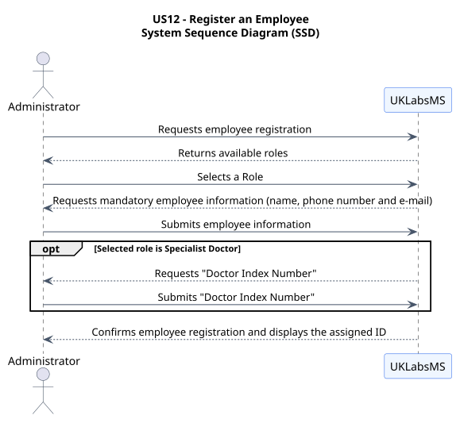
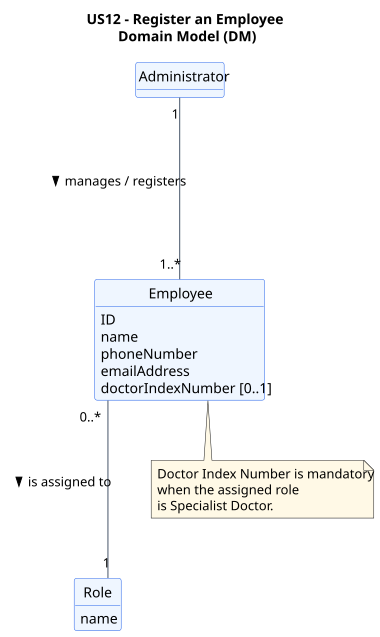
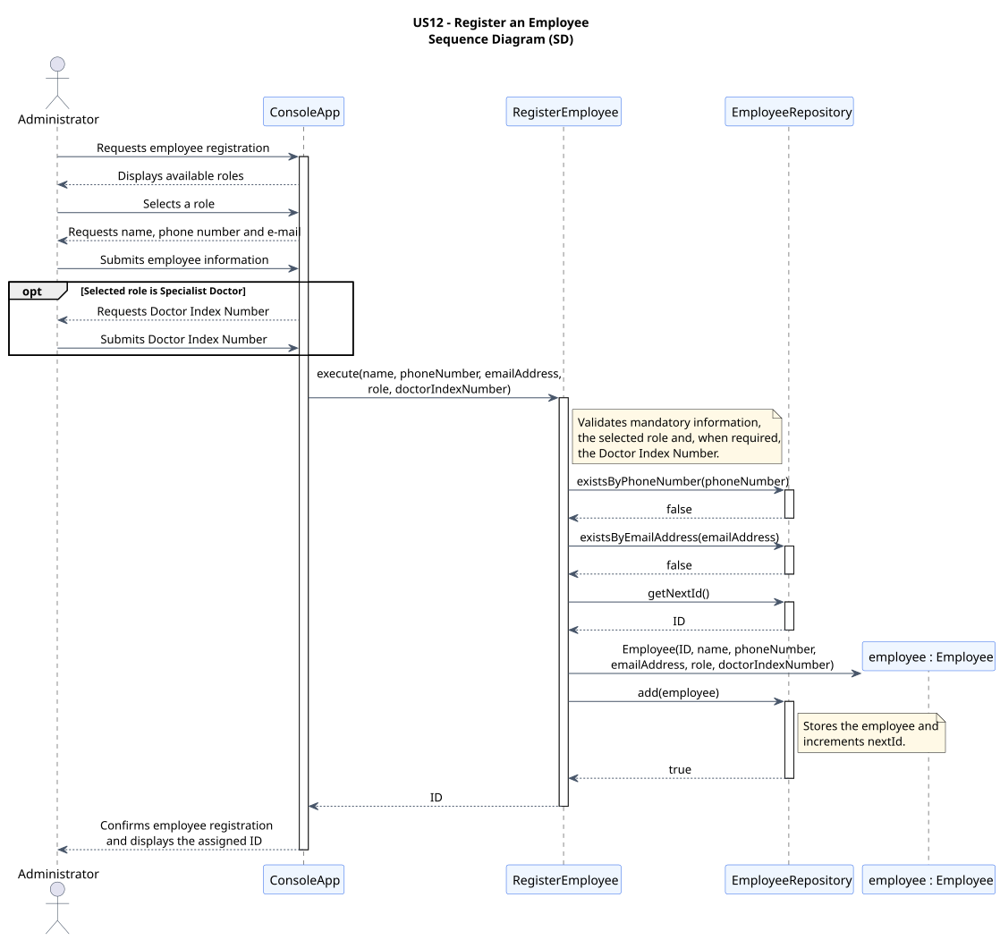
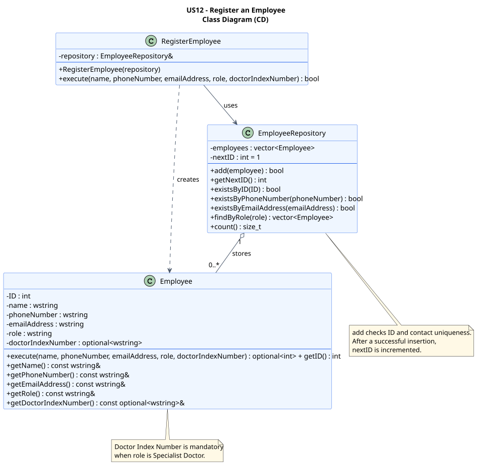

# US 12 - Register an Employee

## 1. Requirements Engineering

### 1.1. User Story Description

As Administrator, I want to register an employee.

### 1.2. Customer Specifications and Clarifications

**From the specifications recorded for US12:**

An Employee is characterized by an automatically generated sequential numeric ID, name, phone number, e-mail address, and exactly one function/role. Name and contact information are mandatory, and both contact fields must be unique across registered employees. A Specialist Doctor must also have the Doctor Index Number assigned by the National Healthcare Service recorded.

The five official acceptance criteria already recorded for US12 are retained in Section 1.3.

**From the client clarifications:**

No additional US12-specific client clarifications are recorded in the supplied documentation. Decisions about contact formats, comparison rules, and the accepted role values remain under Open Issues.

### 1.3. Acceptance Criteria

**Official Acceptance Criteria**

- **AC12-1:** Each employee must be assigned a single function/role within the system.
- **AC12-2:** The ID must be a sequentially generated numeric identifier, starting at 1.
- **AC12-3:** Name, Phone Number and E-mail Address are mandatory fields.
- **AC12-4:** Each employee's Phone Number and E-mail Address must be unique across all registered employees.
- **AC12-5:** When registering a Specialist Doctor, the Doctor Index Number assigned by the National Healthcare Service must be captured.

**Additional Acceptance Criteria - Team Proposals**

- **AC12-6:** When registration succeeds, the system stores the Employee with the assigned ID and submitted information, and informs the Administrator of the successful registration and assigned ID.
- **AC12-7:** When the name, phone number, or e-mail address is missing, the system rejects registration.
- **AC12-8:** When no role or more than one role is assigned, the system rejects registration.
- **AC12-9:** When the phone number is already registered, the system rejects registration.
- **AC12-10:** When the e-mail address is already registered, the system rejects registration.
- **AC12-11:** When the selected role is Specialist Doctor and the Doctor Index Number is missing, the system rejects registration.
- **AC12-12:** When registration fails, the system informs the Administrator, leaves existing employees unchanged, and does not consume the next sequential ID.
- **AC12-13:** An Employee successfully registered through US12 is available to US13 when the same role is selected during the same application session. Both operations use the same Employee model, role values, and EmployeeRepository instance.

### 1.4. Found out Dependencies

- Employee registration has no prerequisite on registering a Test Type in [US10](../US10/US10.md) or a Parameter in [US11](../US11/US11.md). These user stories share the Administrator actor and ConsoleApp, while keeping their respective domain responsibilities.
- [US13 - List Employees by Role](../US13/US13.md) consumes the employees registered through US12. US13 is not a prerequisite for registration; the integration requires a shared Employee model, consistent role values, and the same EmployeeRepository instance.
- The [shared integration overview](../README.md) records the cross-story contracts, current implementation status, and pending verification for the complete application.
- The authentication requirement is shared with the other user stories. The [Supplementary Specification](../global-artifacts/suplementary-specification.md) allows simulated authentication for the prototype; authentication is not currently implemented in ConsoleApp.

### 1.5. Input and Output Data

**Input Data:**

- Typed data:
  - Name
  - Phone number
  - E-mail address
  - Doctor Index Number (mandatory when the selected role is Specialist Doctor)

- Selected data:
  - Exactly one function/role

**Output Data:**

- (In)success of the operation
- Assigned sequential numeric ID after successful registration

The Employee ID is generated by the system and is not entered by the Administrator.

### 1.6. System Sequence Diagram (SSD)

The SSD represents the successful interaction with UKLabsMS as a black box, including conditional collection of the Doctor Index Number. Internal validation, uniqueness checks, and ID generation belong to the design realization.

### 1.7. Other Relevant Remarks

- The Administrator selects exactly one role for each Employee.
- The Doctor Index Number is optional for the general Employee concept and mandatory for a Specialist Doctor.
- Successful registration makes the Employee available for subsequent consultation through US13. A rejected registration does not change the registered employees.
- The proposed prototype retains employees in memory during the current application session. Persistent storage and ID continuity between executions are not implemented.
- The requirements and design below describe the intended US12 behavior. Section 4 distinguishes this design from the current implementation.

### 1.8. Main Success Scenario

1. The Administrator asks to register an Employee.
2. The system presents the available roles.
3. The Administrator selects exactly one role.
4. The system requests the name, phone number, and e-mail address.
5. The Administrator provides the requested data.
6. If the selected role is Specialist Doctor, the system requests the Doctor Index Number and the Administrator provides it.
7. The system validates the mandatory information, the single role assignment, and the Doctor Index Number when required.
8. The system verifies that neither the phone number nor the e-mail address is already registered.
9. The system obtains the next sequential numeric ID, starting at 1 for an initially empty repository.
10. The system registers the Employee with the assigned ID and submitted information, and advances the ID sequence after successful storage.
11. The system informs the Administrator that registration succeeded and displays the assigned ID.

The registered Employee is then available to the US13 role consultation through the shared repository.

### 1.9. Alternative Scenarios

**Alternative 1 - Missing Mandatory Information**

If the name, phone number, or e-mail address is missing, the system rejects registration and informs the Administrator.

**Alternative 2 - Invalid Role Assignment**

If no role or more than one role is assigned, the system rejects registration and informs the Administrator.

**Alternative 3 - Duplicate Phone Number**

If another registered Employee already uses the phone number, the system rejects registration and informs the Administrator.

**Alternative 4 - Duplicate E-mail Address**

If another registered Employee already uses the e-mail address, the system rejects registration and informs the Administrator.

**Alternative 5 - Missing Doctor Index Number**

If the selected role is Specialist Doctor and the Doctor Index Number is missing, the system rejects registration and informs the Administrator.

In all rejection scenarios, no Employee is added, existing records remain unchanged, and the next sequential ID is preserved, as proposed in AC12-12. The SSD and SD represent successful registration; the alternatives are specified here and traced below.

### 1.10. Requirements Traceability

| Acceptance Criteria | Scenario | Verification |
|:---|:---|:---|
| AC12-1 - Exactly one role per Employee. | Main Success Scenario; Alternative 2 | Planned role-assignment validation and single-role selection checks |
| AC12-2 - Sequential numeric ID starting at 1. | Main Success Scenario | Planned repository tests for initial ID, consecutive successful registrations, and unique assigned IDs |
| AC12-3 - Mandatory name, phone number, and e-mail address. | Main Success Scenario; Alternative 1 | Planned tests omitting each mandatory field |
| AC12-4 - Unique phone number and e-mail address. | Main Success Scenario; Alternatives 3 and 4 | Planned duplicate-contact tests with unchanged repository state |
| AC12-5 - Doctor Index Number for Specialist Doctors. | Main Success Scenario; Alternative 5 | Planned Specialist Doctor registration tests with and without the required number |
| AC12-6 - Successful registration stores the data and communicates the assigned ID. | Main Success Scenario | Planned stored-attribute tests, returned-ID tests, and ConsoleApp check |
| AC12-7 - Missing mandatory information causes rejection. | Alternative 1 | Planned registration rejection tests for each missing field |
| AC12-8 - Missing or multiple roles cause rejection. | Alternative 2 | Planned registration validation and interface checks |
| AC12-9 - Duplicate phone number causes rejection. | Alternative 3 | Planned duplicate-phone test |
| AC12-10 - Duplicate e-mail address causes rejection. | Alternative 4 | Planned duplicate-email test |
| AC12-11 - Missing required Doctor Index Number causes rejection. | Alternative 5 | Planned Specialist Doctor rejection test |
| AC12-12 - Rejection is communicated without changing records or consuming an ID. | Alternatives 1-5 | Planned repository snapshot, next-ID, and failure-feedback checks |
| AC12-13 - Registered employees are available to US13 through shared state. | Main Success Scenario followed by US13 consultation | Planned integration test using the same repository for registration and listing |

These verification activities are planned for US12; they are not a report of executed or passing tests.

## 2. OO Analysis

### 2.1. Relevant Domain Model Excerpt

### 2.2. Other Remarks

- `Administrator` is the actor who registers employees. The [Glossary](../global-artifacts/glossary.md) models the Administrator as a separate role from the general Employee concept.
- `Employee` represents a staff member with an ID, name, contact information, and one assigned `Role`. A Role can be assigned to zero or more employees.
- The optional Doctor Index Number becomes mandatory when the assigned role is Specialist Doctor.
- US12 and US13 refer to the same Employee and Role concepts. US12 creates employees; US13 consults them without modifying their information.
- The local diagram is the employee-registration excerpt of the [global Domain Model](../global-artifacts/analysis.md). The global model and the US13 excerpt use the same Employee and Role concepts; professional responsibilities in the clinical workflow provide context rather than an officially validated catalog of role values.
- The Administrator-to-Employee registration association expresses the business interaction. It does not establish a requirement to store the registering Administrator in each Employee record.

## 3. Design - User Story Realization

### 3.1. Rationale

| Interaction ID | Question: Which class is responsible for... | Answer | Justification (with patterns) |
|:---|:---|:---|:---|
| Step 1 | ... interacting with the actor? | ConsoleApp | Pure Fabrication: console interaction is not a responsibility of a domain entity. |
| Step 2 | ... requesting and temporarily keeping the input data? | ConsoleApp | Information Expert: the console interface collects the selected role and employee data. |
|  | ... coordinating employee registration? | RegisterEmployee | Controller: receives the registration request and coordinates validation, creation, and storage. |
| Step 3 | ... validating registration information and the conditional Doctor Index Number? | RegisterEmployee | Information Expert: the service receives the complete registration request and applies the registration rules. |
|  | ... checking contact uniqueness and supplying the next ID? | EmployeeRepository | Information Expert: the repository knows all registered employees and the ID sequence. |
|  | ... creating an Employee? | RegisterEmployee | Creator: the service has the validated initialization data and the ID supplied by the repository. |
|  | ... retaining employee data? | Employee | Information Expert: the entity holds the registered employee's attributes. |
|  | ... storing the Employee and advancing the ID sequence after success? | EmployeeRepository | Information Expert: the repository manages the employee collection and enforces ID and contact uniqueness on insertion. |
| Step 4 | ... displaying the registration outcome and assigned ID? | ConsoleApp | Information Expert: the console interface presents the result to the Administrator. |

### Systematization

According to the rationale, the conceptual class promoted to a software class is:

- Employee

Other software classes (i.e. Pure Fabrication) identified:

- ConsoleApp
- RegisterEmployee
- EmployeeRepository

The conceptual Role is represented by the `role` attribute of Employee in this design. A separate Role software class is not required by the current proposal.

The proposed common contract for US12 and US13, represented consistently in both Class Diagrams, is:

| Element | Proposed shared contract |
|:---|:---|
| Employee | `ID : int`, name, phone number, e-mail address, one role, and optional Doctor Index Number; `getID()` exposes the numeric identifier. |
| EmployeeRepository | Stores the shared employee collection; provides `add(employee)`, `getNextID()`, `existsByID(ID)`, `existsByPhoneNumber(phoneNumber)`, `existsByEmailAddress(emailAddress)`, `findByRole(role)`, and `count()`. |
| ID sequence | `nextID` starts at 1 for an empty repository and advances only after successful insertion. |
| RegisterEmployee | `execute(name, phoneNumber, emailAddress, role, doctorIndexNumber)` returns `std::optional<int>`: the assigned ID on success or no value on rejection. |
| ListEmployeesByRole | Retains the US13 `execute(role)` consultation, delegating to the same repository's `findByRole(role)` without modifying it. |
| Role values | Registration and consultation use the same representation and spelling. The accepted values and any normalization require confirmation. |

This is the target contract, not the current Core API. Both Class Diagrams show the complete shared Employee and repository definitions, plus the registration and consultation services. Their read operations and all Employee getters are const queries. The remaining implementation work is recorded in Sections 4 and 7 and the [shared integration overview](../README.md).

### 3.2. Sequence Diagram (SD)

The proposed success flow is: ConsoleApp collects the data; RegisterEmployee validates it, checks both contacts, obtains the next ID, creates the Employee, and requests insertion. The repository stores the Employee and advances the sequence; the service returns the assigned ID for display.

The SD uses `getNextID()` and `nextID`, matching the shared repository contract. Retrieving the next ID is a read operation; successful insertion advances the sequence. The optional service result contains the assigned numeric ID. The repository lifeline represents the same session instance used by US13.

### 3.3. Class Diagram (CD)

The CD represents the proposed integrated design. Employee holds the complete shared data and exposes `getID() : int`; RegisterEmployee owns the registration operation returning `optional<int>`. EmployeeRepository manages the ID sequence, insertion, uniqueness queries, and role searches. ListEmployeesByRole appears as the US13 consumer of the same repository instance and accesses it through a constant reference. The diagram describes the target design rather than the current implementation.

## 4. Construction (Implementation)

- The current Core contains the US13 Employee, EmployeeRepository, and ListEmployeesByRole classes. RegisterEmployee and the US12 console registration option have not been implemented.
- The existing `Employee` stores `ID` as `std::wstring`, name, and role. It does not yet contain the contact fields or Doctor Index Number required by US12, and does not satisfy AC12-2's numeric ID requirement.
- EmployeeRepository currently provides in-memory storage and role searches, but has no sequential ID generator or contact-uniqueness operations.
- There is an existing API mismatch: Employee exposes `getID()`, while EmployeeRepository, ConsoleApp, and employee tests still call `getCode()`. Targeted syntax checks confirm compilation errors in the repository and ConsoleApp at these calls. The repository declares `existsByCode()`, whereas the proposed shared contract uses `existsByID()`.
- US12 implementation must extend the shared Employee model and repository used by US13, implement RegisterEmployee, and connect registration to ConsoleApp. A separate employee entity or independently populated repository would not provide the required integration.
- Authentication and persistent storage are not currently implemented in ConsoleApp. This document does not claim an executable US12 workflow or passing implementation tests.

## 5. Tests

US12-specific automated tests have not been implemented in the supplied project. The existing employee tests concern the US13 prototype and still use the older Code API. They do not verify the US12 registration criteria.

The planned Google Test coverage follows Section 1.10 and includes:

- Successful registration and retention of all submitted attributes.
- Numeric ID 1 for the first Employee, followed by consecutive IDs after successful registrations.
- Rejection of each missing mandatory field and invalid role assignment.
- Separate rejection tests for duplicate phone numbers and duplicate e-mail addresses.
- Specialist Doctor registration with and without the mandatory Doctor Index Number, and registration of another role without that number.
- Unchanged employee records and ID sequence after each rejected registration.
- The service's returned ID matching the stored Employee ID.
- Registration followed by US13 listing through the same repository, checking the returned Employee's ID, name, and role.
- Repeated role consultations preserving the employee collection and ID sequence.

ConsoleApp verification must cover input collection, conditional Doctor Index Number prompts, success and rejection feedback, and display of the generated ID. Existing US10, US11, and US13 regression tests must also pass after the shared employee API is aligned. No test execution result is asserted here.

## 6. Integration and Demo

The intended integration uses one EmployeeRepository instance for the lifetime of the application session. ConsoleApp supplies that instance to both RegisterEmployee and ListEmployeesByRole. This allows US13 to retrieve the employees created through US12 without copying records between repositories.

US10 and US11 retain their Test Type and Parameter responsibilities. Employee registration neither creates those catalog entries nor establishes their TestTypeParameter associations. All four user stories are designed to coexist in the same application with consistent Administrator terminology.

Role values must be shared by registration and consultation. The current US13 search compares role strings exactly and is case-sensitive; until a different rule is confirmed and implemented, both flows must supply the same stored value. The global model's professional roles provide context, not a confirmed list of accepted registration values.

**Planned demonstration after implementation:**

1. Register an Employee through US12 and note the generated numeric ID.
2. Select the same role in US13 and verify that the Employee appears with the same ID, name, and role.
3. Register another Employee with that role and distinct contacts; verify the next ID and that US13 returns both employees.
4. Attempt registration with a duplicate phone number or e-mail address; verify rejection and an unchanged US13 result.
5. Register a Specialist Doctor with the required Doctor Index Number, then verify that omitting it causes rejection.
6. Confirm that employee consultation does not change the records and that US10 and US11 remain available in the menu.

**Current status:** ConsoleApp offers US10, US11, and US13, and creates an initially empty EmployeeRepository for US13. It has no US12 registration option. The shared-repository registration-to-listing demonstration remains pending, together with the API corrections described in Section 4.

## 7. Open Issues

- Which role values are accepted? How should the separate professional roles in the global model map to the shared Employee/Role representation, including the canonical value for Specialist Doctor?
- What format and comparison rules apply to phone numbers and e-mail addresses, including whitespace, phone prefixes, and e-mail letter case? No additional format rule is treated as official here.
- What format and uniqueness rules apply to the Doctor Index Number? Should it be rejected or ignored when supplied for another role?
- How should the ID sequence be preserved when persistent storage is introduced?
- The implemented Employee model, repository, ConsoleApp, and tests must be aligned with the documented numeric ID and contact fields. The remaining `getCode()`/`existsByCode()` references must be reconciled with the documented `getID()`/`existsByID()` API.
- RegisterEmployee, the console registration option, US12 tests, and the complete US12-to-US13 demonstration remain to be implemented and verified.

## 8. Conclusion

US12 - Register an Employee is documented through requirements engineering, object-oriented analysis, and a proposed registration design, following the structure used by US10 and US11.

The five official acceptance criteria are preserved. Additional team proposals make the registration outcomes, failure-state behavior, and shared-repository integration with US13 explicit. The scenarios and planned verification activities are traced to these criteria.

US12 supplies the employees that US13 consults. Their intended integration uses one Employee model, consistent role values, and the same repository instance, while US10 and US11 retain their catalog responsibilities.

The shared Domain Model and the US12 and US13 design diagrams use consistent concepts, class definitions, and operation names. The supplied code still contains the implementation and API gaps recorded in Sections 4 and 7. The documentation defines the intended integrated behavior without presenting those pending code changes or tests as completed.

## 9. References

- LETI-ESOFT 2026/2027 - Project Assignment.
- LETI-ESOFT 2026/2027 - Sprint 2.
- [Shared Integration Overview](../README.md).
- [Project Glossary](../global-artifacts/glossary.md).
- [OO Analysis and Global Domain Model](../global-artifacts/analysis.md).
- [Supplementary Specification](../global-artifacts/suplementary-specification.md).
- [Global Use Case Diagram Documentation](../global-artifacts/use-case-diagram.md).
- [US10 - Register a Test Type](../US10/US10.md).
- [US11 - Register a Parameter](../US11/US11.md).
- [US13 - List Employees by Role](../US13/US13.md).
