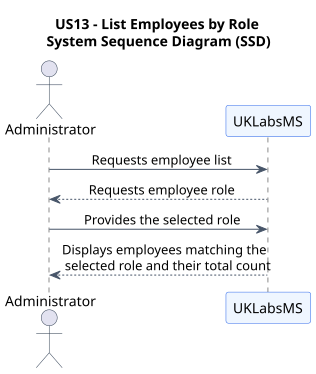
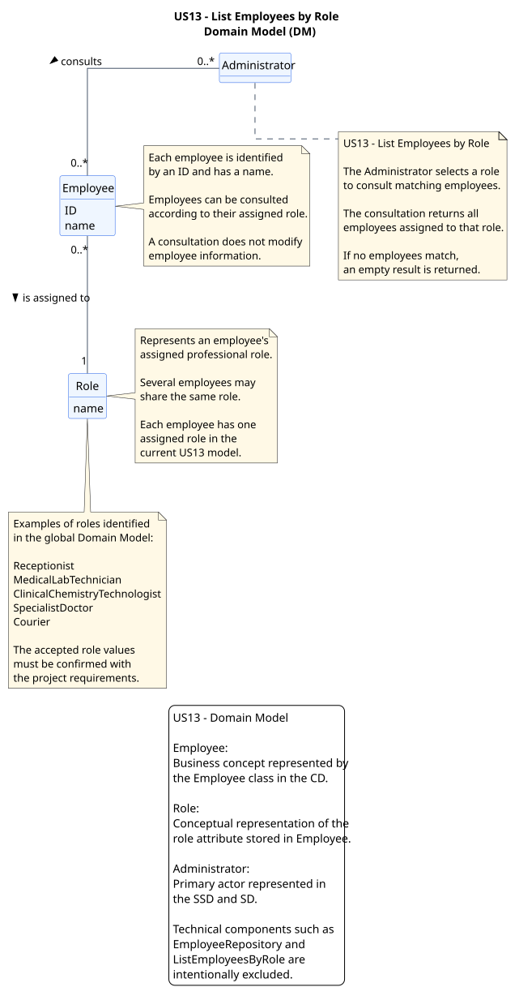
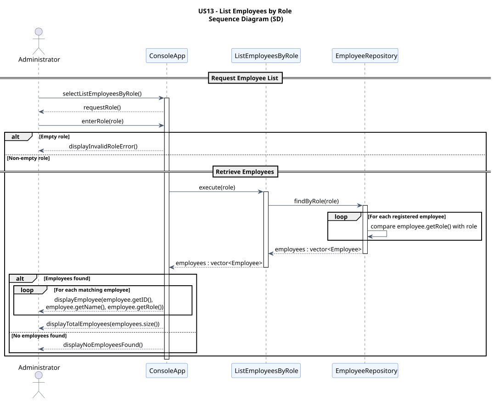

# US 13 - List Employees by Role

## 1. Requirements Engineering

### 1.1. User Story Description

As Administrator, I want to list employees by role.

### 1.2. Customer Specifications and Clarifications

**From the specifications recorded for US13:**

>The Administrator consults registered employees according to their role. The current design retrieves all employees matching one supplied role and performs a read-only consultation.

>The exact official acceptance criteria must still be checked against the Sprint 2 assignment. The behavior detailed below is retained as team proposals rather than presented as verified stakeholder criteria.

**From the client clarifications:**

No US13-specific client clarifications are recorded in the supplied documentation. The accepted role values, matching rules, displayed attributes, and ordering remain under Open Issues.

### 1.3. Acceptance Criteria

**Official Acceptance Criteria**

No verified official acceptance criteria are recorded in the supplied US13 documentation. AC13-1 is therefore not assigned here; the existing AC13-2 to AC13-9 identifiers are preserved for traceability.

**Additional Acceptance Criteria - Team Proposals**

- **AC13-2:** The Administrator must provide a role to perform the consultation.
- **AC13-3:** The system must retrieve employees whose registered role matches the selected role.
- **AC13-4:** If multiple employees have the selected role, the system must return all matching employees.
- **AC13-5:** If no employees match the selected role, the system must display an appropriate message.
- **AC13-6:** If the employee repository is empty, the system must display an appropriate message.
- **AC13-7:** The consultation must not modify existing employee information.
- **AC13-8:** The system must display the ID, name and role of each matching employee.
- **AC13-9:** The system must reject an empty role entered through the ConsoleApp.
- **AC13-10:** When matching employees are found, the system displays their total count. This is the number of matching employees, not the number of all registered employees.
- **AC13-11:** Employees successfully registered through US12 are available to US13 when the same role is supplied during the same application session. Both operations use the same Employee model, role values, and EmployeeRepository instance.

### 1.4. Found out Dependencies

- [US12 - Register an Employee](../US12/US12.md) supplies the employee records for the integrated registration-to-consultation workflow. US13 must use the same Employee model and EmployeeRepository instance, and the same role representation, as specified by US12's proposed shared contract and AC12-13.
- The [shared integration overview](../README.md) records the cross-story contracts, current implementation status, and pending verification for the complete application.
- Prior registration is needed to demonstrate a non-empty result, but is not a precondition for performing the consultation. An empty repository is a valid alternative scenario.
- [US10](../US10/US10.md) and [US11](../US11/US11.md) share the Administrator actor and ConsoleApp with US13. Registering Test Types or Parameters is not a prerequisite for listing employees.
- The authentication requirement is shared with the other user stories. The [Supplementary Specification](../global-artifacts/suplementary-specification.md) allows simulated authentication for the prototype; authentication is not currently implemented in ConsoleApp.

### 1.5. Input and Output Data

**Input Data:**

- Typed data:
  - Employee role, entered as text in the current ConsoleApp

- Selected data:
  - n/a in the current interface; a shared role-selection mechanism remains to be agreed with US12

**Output Data:**

- ID, name, and role of each matching Employee
- Total number of matching employees when results are found
- Message when no employees are found, including an empty repository
- Error message when an empty role is entered

The selected role in the scenarios means the role supplied for the consultation; the current interface does not provide a predefined role menu.

### 1.6. System Sequence Diagram (SSD)

The SSD shows the successful interaction between the Administrator and UKLabsMS as a black box: requesting a list, supplying a role, and receiving the matching employees and their count. Empty input and empty results are documented in Section 1.9 and represented in the SD.

### 1.7. Other Relevant Remarks

- The primary actor is the Administrator, and an EmployeeRepository must be available to the application. A non-empty result requires at least one registered Employee with the supplied role.
- The proposed business rules are read-only consultation (BR13-01), matching by registered role (BR13-02), an empty result when no employees match (BR13-03), and displaying ID, name, and role (BR13-04). They are reflected in AC13-3, AC13-5, AC13-7, and AC13-8.
- The current repository compares role strings exactly and is case-sensitive. For example, `Receptionist` and `receptionist` produce different matches. This is an implementation decision, not a confirmed official requirement.
- US13 displays a subset of the shared Employee information. Contact details and the conditional Doctor Index Number required by US12 remain part of the common entity even when they are not displayed by this consultation.
- The consultation does not create employees, assign IDs, or advance the ID sequence. Those responsibilities belong to US12 and the shared repository.
- Employee storage is currently in memory. Records are not persisted between application executions.

### 1.8. Main Success Scenario

1. The Administrator asks to list employees by role.
2. The system requests the employee role.
3. The Administrator provides the desired role.
4. The system verifies that the supplied role is not empty.
5. The system searches the shared employee repository for employees whose registered role matches the supplied role.
6. The system retrieves all matching employees.
7. The system displays the ID, name, and role of each matching Employee.
8. The system displays the total number of matching employees.

The registered employees remain unchanged throughout the consultation. In the integrated workflow, the displayed IDs are the same numeric IDs generated during US12 registration.

### 1.9. Alternative Scenarios

**Alternative 1 - Empty Role**

If the Administrator enters an empty role, ConsoleApp rejects the input, displays an error message, and does not invoke the consultation service. The current check rejects an empty string; handling input consisting only of whitespace remains under Open Issues.

**Alternative 2 - No Employees Match the Role**

If the supplied role has no matching employees, the repository returns an empty collection and the system informs the Administrator that no employees were found. An unknown role also produces this outcome under the current exact-match behavior.

**Alternative 3 - Empty Employee Repository**

If no employees are registered, the consultation returns an empty collection and the system displays the same no-employees-found message. The system does not create records to populate the result.

**Alternative 4 - Different Letter Case in the Role**

Under the current case-sensitive comparison, a role entered with different letter casing does not match an otherwise identically spelled stored role. If no employees match the exact supplied value, Alternative 2 applies. Any change to this comparison must be coordinated with US12.

All alternatives leave existing employee records unchanged. No matching results is a valid consultation outcome rather than a registration failure.

### 1.10. Requirements Traceability

| Acceptance Criteria | Scenario | Verification |
|:---|:---|:---|
| AC13-2 - A role is supplied for consultation. | Main Success Scenario; Alternative 1 | ConsoleApp input check; planned interface verification |
| AC13-3 - Employees match the supplied role. | Main Success Scenario; Alternatives 2 and 4 | Existing repository and service test cases; role-matching behavior requires confirmation |
| AC13-4 - All employees with the role are returned. | Main Success Scenario | Existing multiple-employees test case; planned verification that other roles are excluded |
| AC13-5 - No matches produces an appropriate message. | Alternative 2 | Existing unknown-role repository and service test cases; planned console feedback check |
| AC13-6 - An empty repository produces an appropriate message. | Alternative 3 | Existing empty-repository test case; planned console feedback check |
| AC13-7 - Consultation does not modify employee information. | Main Success Scenario; Alternatives 1-4 | Existing count-preservation test; planned full-record and ID-sequence checks |
| AC13-8 - Each result displays ID, name, and role. | Main Success Scenario | Planned console output verification after the Employee ID API is aligned |
| AC13-9 - Empty console input is rejected. | Alternative 1 | Existing ConsoleApp validation; planned check that the service is not invoked |
| AC13-10 - Displayed count equals the number of matches. | Main Success Scenario | Planned output check with employees from multiple roles |
| AC13-11 - US12 registrations are visible through the shared repository. | US12 registration followed by Main Success Scenario | Planned integration test checking the same Employee ID, name, and role |

Existing test cases describe the coverage present in the source; they are not a report of a successful current test run. Section 5 distinguishes existing checks from planned verification.

## 2. OO Analysis

### 2.1. Relevant Domain Model Excerpt

### 2.2. Other Remarks

- `Administrator` requests the consultation. The Administrator-to-Employee association expresses a business interaction and does not imply ownership or modification of employee records.
- `Employee` is the same staff-member concept registered through US12. The local excerpt emphasizes ID and name because they are relevant to listing; it does not define a second, reduced Employee entity.
- Each Employee has exactly one `Role`, while a Role can be assigned to zero or more employees. This is consistent with US12's single-role requirement.
- The conceptual Role is stored as the Employee's `role` attribute in the current software design; no separate Role software class is implemented.
- EmployeeRepository and ListEmployeesByRole are software components and do not appear as business concepts in the Domain Model.
- The local diagram is the employee-consultation excerpt of the [global Domain Model](../global-artifacts/analysis.md). The global model and US12 use the same Employee and Role concepts. Professional responsibilities shown in the clinical workflow provide context and do not establish an officially accepted role catalog.

## 3. Design - User Story Realization

### 3.1. Rationale

| Interaction ID | Question: Which class is responsible for... | Answer | Justification (with patterns) |
|:---|:---|:---|:---|
| Step 1 | ... interacting with the actor? | ConsoleApp | Pure Fabrication: console interaction is not a responsibility of a domain entity. |
| Step 2 | ... requesting the role and rejecting empty console input? | ConsoleApp | Information Expert: the interface handles the consultation input before invoking the service. |
|  | ... coordinating the consultation? | ListEmployeesByRole | Controller: receives the request and delegates employee retrieval to the repository. |
| Step 3 | ... finding all employees with the supplied role? | EmployeeRepository | Information Expert: the repository knows the registered employees and their roles. |
|  | ... providing each Employee's ID, name, and role? | Employee | Information Expert: the entity holds its own employee information. |
|  | ... preserving read-only access through the service? | ListEmployeesByRole | Low Coupling: the service queries through a constant repository reference without depending on registration operations. |
| Step 4 | ... displaying the results, match count, or no-results message? | ConsoleApp | Information Expert: the interface presents the returned collection and derives the count from that collection. |

### Systematization

According to the rationale, the conceptual class promoted to a software class is:

- Employee

Other software classes (i.e. Pure Fabrication) identified:

- ConsoleApp
- ListEmployeesByRole
- EmployeeRepository

Employee and EmployeeRepository are shared with US12. Their complete definitions are identical in both Class Diagrams. The target contract follows Section 3.1 of [US12](../US12/US12.md):

| Element | Shared contract and consultation responsibility |
|:---|:---|
| Employee | Numeric `ID : int`, name, phone number, e-mail address, one role, and optional Doctor Index Number. US13 displays `getID()`, `getName()`, and `getRole()`. |
| EmployeeRepository | One instance stores the session's employees. US13 calls `findByRole(role)` through a constant reference; registration and ID-generation operations remain part of the US12 contract. |
| ListEmployeesByRole | `execute(role) const` returns `std::vector<Employee>` by delegating to `findByRole(role)`. An empty vector represents no matches. |
| ConsoleApp | Collects the role, displays the returned employees, and uses the returned collection's size for the match count. |
| Role values | Registration and consultation use the same representation and spelling. Any normalization or catalog must be agreed and applied consistently. |

The shared numeric ID and complete Employee attributes are the proposed integrated contract. The current implementation differences are recorded in Section 4.

### 3.2. Sequence Diagram (SD)

ConsoleApp collects the role and rejects empty input. Otherwise, it calls `ListEmployeesByRole::execute(role)`, which delegates to `EmployeeRepository::findByRole(role)`. The returned collection is displayed with its size, or produces a no-employees-found message. The SD includes both the empty-role and no-results alternatives.

### 3.3. Class Diagram (CD)

The CD shows the proposed complete Employee and EmployeeRepository shared with US12, including the numeric ID, contact fields, conditional Doctor Index Number, ID sequence, and registration-side uniqueness queries. RegisterEmployee appears to make the shared producer-to-consumer relationship explicit. ListEmployeesByRole holds a constant reference to the same repository, and its `execute(role)` operation is const.

The diagram uses `getID()` and `existsByID(ID)` consistently with the US12 contract. US13 itself only requires `findByRole(role)` for its consultation flow; the remaining repository operations support US12 and shared collection management. The implementation differences are recorded in Section 4.

## 4. Construction (Implementation)

- Employee, EmployeeRepository, and ListEmployeesByRole exist in the Core employee module. ConsoleApp includes the `3 - List Employees by Role (US13)` option.
- The current Employee holds `ID : std::wstring`, name, and role. It must be extended to meet the common US12 contract, including a sequential numeric ID, contact information, and the conditional Doctor Index Number.
- EmployeeRepository uses an in-memory collection and compares roles with exact, case-sensitive string equality. ListEmployeesByRole receives a constant repository reference and returns the collection produced by `findByRole(role)`.
- Empty-role validation currently occurs only in ConsoleApp through `role.empty()`. The service and repository do not independently reject an empty role, and whitespace-only input is not rejected by that console check.
- ConsoleApp contains the result-display and no-results branches, and derives the displayed match count from `employees.size()`.
- An existing API mismatch remains: Employee exposes `getID()`, while the repository implementation, ConsoleApp, and employee tests call `getCode()`. Targeted syntax checks confirm compilation errors in the repository and ConsoleApp at these calls. The current display also labels the identifier as `Code:`. These references must be aligned with the shared Employee ID contract before the application can build and its output behavior can be verified.
- ConsoleApp creates an initially empty EmployeeRepository for the consultation service. RegisterEmployee and the US12 console registration option do not yet exist, so the complete registration-to-listing workflow is not implemented.
- Authentication and persistent employee storage are not currently implemented in ConsoleApp.

## 5. Tests

The existing employee test source, `CoreTests/domain/employee/EmployeeTests.cpp` in the project repository, contains Google Test cases covering employee information, insertion, duplicate identifiers, role searches, multiple matches, unknown roles, an empty repository, identifier existence, consultation-service delegation, repository count preservation, and case-sensitive matching. Source-code files are referenced by repository path and are not part of this documentation archive.

Those tests still use `getCode()` and `existsByCode()`, while Employee declares `getID()`. Earlier documentation reported passing automated and manual checks, but targeted syntax checks now confirm the repository and ConsoleApp compilation errors described in Section 4. No US13 Google Test suite or US13 ConsoleApp scenario was executed as part of this documentation update; the historical reports do not establish a passing result for the current source. Results for the other modules are recorded in the [shared integration overview](../README.md).

Verification after API alignment must include:

- Running the existing employee tests against the shared model and numeric IDs.
- Returning every matching Employee while excluding employees with other roles.
- Handling an unknown role and an empty repository with an empty result and appropriate console feedback.
- Rejecting empty console input without invoking the consultation service.
- Displaying the same ID, name, and role stored for each Employee.
- Displaying the number of matches when the repository also contains employees with other roles.
- Comparing employee attributes before and after consultation; the existing read-only test checks only the repository count.
- Verifying that consultation does not consume or alter the shared repository's future ID sequence.
- Registering employees through US12 and listing them through US13 using the same repository, including a Specialist Doctor whose full stored information remains unchanged.
- Running the existing US10 and US11 regression tests and, once implemented, the US12 registration tests after shared employee changes.

Case-sensitive behavior has an existing test case. It must be retained or revised according to the role-matching rule agreed for both US12 and US13. Console feedback and the complete registration-to-listing demonstration remain to be verified.

## 6. Integration and Demo

The intended integration is the same as documented in US12: ConsoleApp owns one EmployeeRepository instance for the application session and supplies it to both RegisterEmployee and ListEmployeesByRole. US12 stores employees in that instance; US13 queries it through a constant reference. An independently populated second repository would not integrate the workflows.

Both user stories use the same Employee identifiers and role values. US13 displays the ID generated by US12 and does not generate another identifier. The consultation's reduced output does not remove contact information or the Doctor Index Number from the shared entity.

US10 and US11 retain their Test Type and Parameter responsibilities alongside the employee operations. Employee consultation does not depend on their catalog data or modify it.

**Planned demonstration after implementation and API alignment:**

1. Consult a role in an empty employee repository and verify the no-employees-found message.
2. Register an Employee through US12, note the generated numeric ID, and consult the exact same role through US13.
3. Verify that the result contains the registered Employee with the same ID, name, and role, and a match count of one.
4. Register another Employee with that role and an Employee with a different role. Consult the first role and verify that exactly the two matching employees are displayed.
5. Attempt a US12 registration with a duplicate contact and verify that rejection leaves the US13 result unchanged.
6. Consult an unmatched role and enter an empty role to verify the two distinct feedback paths.
7. Repeat a successful consultation and verify unchanged employee records and ID sequence; confirm that the US10 and US11 menu options remain available.

**Current status:** The US13 menu entry and consultation classes exist. The employee API mismatch and missing US12 registration flow prevent treating the integrated demonstration as completed. Earlier manual reports concerned the empty-repository scenario; positive console results still require verification with employees registered through US12.

## 7. Open Issues

- **OI13-01:** What are the exact official acceptance criteria for US13? They must be checked against the Sprint 2 assignment before replacing the current proposal status.
- **OI13-02:** Which employee role values are accepted? The implemented representation, including Specialist Doctor, must use the same values as US12. The shared conceptual Role does not define an approved value catalog.
- **OI13-03:** Should matching remain case-sensitive, or should both stories normalize role values? Should whitespace-only role input be rejected, and where should that validation occur?
- **OI13-04:** Which attributes must be displayed? ID, name, and role are the current proposal; the complete shared entity must retain the US12 attributes regardless of the output subset.
- **OI13-05:** Does the stakeholder require one selected role per consultation or all employees grouped by role? The current design implements one supplied role.
- **OI13-06:** The shared-repository integration is defined consistently in the US12 and US13 design artifacts, but remains to be implemented: extend the shared Employee and repository, add registration, and reconcile `getCode()`/`existsByCode()` with `getID()`/`existsByID()`. Update the console identifier label to the common numeric ID contract.
- **OI13-07:** Is a particular sorting order required? No explicit sorting rule is implemented or treated as an acceptance criterion.
- The build, automated tests, console output, and the complete US12-to-US13 demonstration must be verified after the confirmed compilation errors and pending implementation work are resolved.

## 8. Conclusion

US13 - List Employees by Role is documented through requirements engineering, object-oriented analysis, and design using the structure adopted by US10, US11, and US12.

The existing AC13-2 to AC13-9 remain team proposals, with additional proposals for the matching-result count and integration with US12. Scenarios and verification activities are traced to these criteria without inventing official acceptance criteria.

US13 consults the same employees that US12 registers, using the same repository instance and role representation. It returns all matches without modifying employee information or generating IDs. US10 and US11 retain their catalog responsibilities in the shared application.

The shared Domain Model and the US12 and US13 design diagrams use consistent concepts, class definitions, and operation names. The supplied implementation contains the consultation components, but its Employee ID API, data model, and registration-to-listing workflow still require alignment with that design and verification. Existing test sources and historical test reports are distinguished from pending validation of the current version.

## 9. References

- LETI-ESOFT 2026/2027 - Project Assignment.
- LETI-ESOFT 2026/2027 - Sprint 2.
- [Shared Integration Overview](../README.md).
- [Project Glossary](../global-artifacts/glossary.md).
- [OO Analysis and Global Domain Model](../global-artifacts/analysis.md).
- [Supplementary Specification](../global-artifacts/suplementary-specification.md).
- [US10 - Register a Test Type](../US10/US10.md).
- [US11 - Register a Parameter](../US11/US11.md).
- [US12 - Register an Employee](../US12/US12.md).
