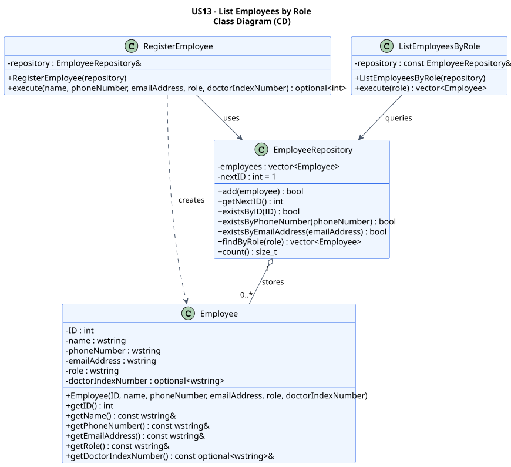

# US13 — List Employees by Role

**Project:** UK Labs Management System (UKLabsMS)  
**Course:** LETI-ESOFT 2026/2027  
**Team:** B6  
**Sprint:** 2  
**Priority:** To be confirmed

## 1. User Story

**US13:** As Administrator, I want to list employees by role.

## 2. Description

This user story allows an Administrator to consult employees registered in the UKLabsMS according to their role.

The Administrator provides a role, and the system retrieves the employees associated with that role.

The implementation uses an employee repository to store employee information and a dedicated service to perform the consultation.

The operation is read-only and does not modify employee records.

The current prototype uses in-memory storage.

## 3. Actors

**Primary Actor:** Administrator

**Supporting Actors:** None identified.

## 4. Preconditions

- PRE13-01: The Administrator is authenticated in the system. Authentication is not currently implemented in the ConsoleApp.
- PRE13-02: The system is available.
- PRE13-03: An employee repository is available to the application.

## 5. Acceptance Criteria

### 5.1 Official Acceptance Criteria

The official acceptance criteria for US13 must be verified against the Sprint 2 assignment before final submission.

The current implementation supports listing employees by a selected role. This behavior should be checked against the exact requirements provided by the stakeholder.

### 5.2 Additional Acceptance Criteria — Team Proposals

The following criteria describe the implemented behavior. They are proposed requirements and should be validated with the stakeholder.

**AC13-2:** The Administrator must provide a role to perform the consultation.

**AC13-3:** The system must retrieve employees whose registered role matches the selected role.

**AC13-4:** If multiple employees have the selected role, the system must return all matching employees.

**AC13-5:** If no employees match the selected role, the system must display an appropriate message.

**AC13-6:** If the employee repository is empty, the system must display an appropriate message.

**AC13-7:** The consultation must not modify existing employee information.

**AC13-8:** The system must display the code, name and role of each matching employee.

**AC13-9:** The system must reject an empty role entered through the ConsoleApp.

## 6. Main Success Scenario

1. The Administrator selects the option to list employees by role.
2. The system requests the employee role.
3. The Administrator enters the desired role.
4. The system validates that the role is not empty.
5. The system searches the employee repository for matching employees.
6. The repository returns the employees associated with the selected role.
7. The system displays the matching employees.
8. The system displays the total number of employees found.

## 7. Alternative and Exception Scenarios

### 7.1 Empty Role

If the Administrator provides an empty role:

1. The system rejects the input.
2. The system displays an appropriate error message.
3. No consultation is performed.

### 7.2 No Employees Found

If no employees match the selected role:

1. The repository returns an empty list.
2. The system informs the Administrator that no employees were found.
3. No employee information is modified.

### 7.3 Empty Employee Repository

If the repository contains no employees:

1. The Administrator selects a role.
2. The system performs the consultation.
3. The repository returns an empty list.
4. The system displays an appropriate message.

### 7.4 Case-Sensitive Role Matching

The current implementation performs an exact, case-sensitive comparison of roles.

For example, `Receptionist` and `receptionist` are considered different values.

This behavior is provisional and should be confirmed against the requirements and the employee model used by US12.

## 8. Postconditions

### Success Postcondition

The system displays all employees matching the selected role.

The repository remains unchanged.

### Alternative Postcondition

If no matching employees exist, the system displays an appropriate message.

No employee records are created, modified or deleted.

## 9. Business Rules

**BR13-01 (Proposed):** Employee consultations must not modify employee records.

**BR13-02 (Proposed):** Employees are selected according to their registered role.

**BR13-03 (Proposed):** If no employees match the selected role, an empty result is returned.

**BR13-04 (Proposed):** Each employee displayed in the current prototype contains a code, name and role.

### 9.1 Role Matching

The `EmployeeRepository` class searches employees by comparing their stored role with the role supplied by the Administrator.

The current implementation uses exact string matching.

Role normalization, predefined role values and case-insensitive matching have not yet been implemented.

These decisions should be coordinated with US12.

### 9.2 Employee Information

The current `Employee` class contains:

- Code
- Name
- Role

These fields are sufficient for the current US13 prototype.

However, the final employee entity should be aligned with the complete employee information required by US12.

## 10. Requirements Traceability

| Requirement | Acceptance Criteria | Verification |
|:---|:---|:---|
| List employees by role | US13, AC13-3 | Unit tests and manual console testing |
| Return all matching employees | AC13-4 | Unit tests |
| Handle unknown roles | AC13-5 | Unit tests |
| Handle an empty repository | AC13-6 | Unit tests and manual testing |
| Read-only consultation | AC13-7 | Unit tests |
| Display employee information | AC13-8 | Manual console testing when employee records are available |
| Reject empty roles | AC13-9 | Console input validation |

## 11. Open Issues

- **OI13-01:** What are the exact official acceptance criteria for US13?
- **OI13-02:** Which employee roles are valid according to the project requirements?
- **OI13-03:** Should role matching be case-sensitive?
- **OI13-04:** Which employee attributes must be displayed?
- **OI13-05:** Should the system list employees for one selected role or group all employees by role?
- **OI13-06:** How will US13 access the employees registered through US12?
- **OI13-07:** Should employees be sorted by name, code or another attribute?

## 12. References

- LETI-ESOFT 2026/2027 — Project Assignment.
- LETI-ESOFT 2026/2027 — Project Sprint 2.
- UKLabsMS Glossary.
- UKLabsMS Domain Model.
- US11 — Register Parameter.
- US12 — Register Employee.

## 13. System Sequence Diagram (SSD)

The System Sequence Diagram represents the interaction between the Administrator and the UKLabsMS during an employee consultation.

The system is represented as a black box.

The diagram should include:

- The Administrator requesting an employee list.
- The system requesting the role.
- The Administrator providing the role.
- The system returning matching employees.
- The alternative scenario where no employees are found.

### 13.1 SSD Description

The Administrator initiates the consultation by selecting the corresponding menu option.

The system requests the employee role.

After receiving the role, the system searches for matching employees.

If matching employees exist, the system displays their information.

Otherwise, the system informs the Administrator that no employees were found.

## 14. Class Diagram (CD)

The Class Diagram represents the main classes involved in US13.

The current implementation includes:

- `Employee`
- `EmployeeRepository`
- `ListEmployeesByRole`

The `Employee` class represents an employee.

The `EmployeeRepository` class stores employees and provides search operations.

The `ListEmployeesByRole` class coordinates the consultation of employees according to their role.

### 14.1 Class Responsibilities

| Class | Responsibility |
|:---|:---|
| Employee | Represents employee information |
| EmployeeRepository | Stores employees and provides role-based searches |
| ListEmployeesByRole | Coordinates employee consultations |

### 14.2 Design Considerations

The implementation separates employee information, data access and consultation logic.

`ListEmployeesByRole` receives a constant reference to `EmployeeRepository`.

This prevents the consultation service from modifying the repository through that reference.

The employee repository is implemented using an in-memory collection.

The final employee data model should be shared with US12.

## 15. Sequence Diagram (SD)

The Sequence Diagram represents the internal interactions between the components involved in listing employees by role.

The main participants are:

- Administrator
- ConsoleApp
- ListEmployeesByRole
- EmployeeRepository

### 15.1 Main Success Scenario

1. The Administrator selects the option to list employees by role.
2. The ConsoleApp requests the role.
3. The Administrator enters the role.
4. The ConsoleApp validates that the role is not empty.
5. The ConsoleApp invokes `ListEmployeesByRole::execute(role)`.
6. The service invokes `EmployeeRepository::findByRole(role)`.
7. The repository searches its employee collection.
8. The repository returns all matching employees.
9. The service returns the result to the ConsoleApp.
10. The ConsoleApp displays the matching employees and their total count.

### 15.2 Alternative Scenario

If no employees match the selected role, the repository returns an empty collection.

The service returns the empty collection to the ConsoleApp.

The ConsoleApp displays an appropriate message.

## 16. Implementation and Testing

### 16.1 Implementation

US13 was implemented in C++ using the following files:

**Domain Entity**

- `Core/headers/domain/employee/Employee.h`
- `Core/sources/domain/employee/Employee.cpp`

**Repository**

- `Core/headers/domain/employee/EmployeeRepository.h`
- `Core/sources/domain/employee/EmployeeRepository.cpp`

**Consultation Service**

- `Core/headers/domain/employee/ListEmployeesByRole.h`
- `Core/sources/domain/employee/ListEmployeesByRole.cpp`

**Console Application**

- `ConsoleApp/ConsoleApp.cpp`

**Unit Tests**

- `CoreTests/domain/employee/EmployeeTests.cpp`

### 16.2 Automated Testing

The implementation was tested using Google Test.

The reported results were:

- 33 previously existing tests.
- 12 additional tests associated with US13.

**Total: 45 tests passed.**

The US13 tests verify:

- Employee information storage.
- Successful insertion into the repository.
- Duplicate employee code rejection.
- Role-based searches.
- Multiple employees with the same role.
- Unknown roles.
- Empty repositories.
- Employee code existence.
- Consultation through the application service.
- Read-only behavior.
- Case-sensitive role matching.

### 16.3 Manual Testing

The US13 functionality was manually tested through the ConsoleApp.

**Scenario — Empty Employee Repository**

The Administrator selected the employee consultation option and entered `Receptionist`.

**Expected Result:** The system displays a message indicating that no employees were found.

**Observed Result:** The expected message was displayed.

The ConsoleApp currently initializes an empty employee repository.

Therefore, the display of matching employee records has not yet been verified through the complete console workflow.

### 16.4 Compatibility With US11

The implementation of US13 uses separate employee domain classes and services.

The existing US11 classes remain unchanged:

- `Parameter`
- `ParameterRepository`
- `RegisterParameter`
- `MetricType`

Both user stories are available through the same ConsoleApp menu.

The existing tests continued to pass after the integration.

### 16.5 Integration With US12

US12 is responsible for registering employees.

The current US13 implementation uses its own shared employee entity and repository structure, but the ConsoleApp does not yet receive employee records from US12.

Integration with US12 will require the registration and consultation functionalities to access the same employee repository.

Employee attributes and role definitions must also be aligned with US12.

### 16.6 Data Storage

The current implementation uses in-memory storage.

Employee information remains available while the application is running.

Data is not persisted between executions.

## 17. Conclusion

US13 — List Employees by Role was implemented in C++ using an employee entity, an in-memory repository, a consultation service and a console interface.

The implementation supports searching employees according to a selected role and handles cases where no matching employees exist.

The consultation is read-only and does not modify employee records.

The functionality was verified through automated tests and manual console testing.

The project currently passes 45 automated tests, including the existing tests associated with US11.

The three UML diagrams (SSD, CD and SD) have been completed.

The remaining work includes confirmation of the official acceptance criteria and integration with US12.

The implementation is functional for the scenarios tested, but the employee registration and consultation workflows must be integrated before the complete system can be considered finalized.