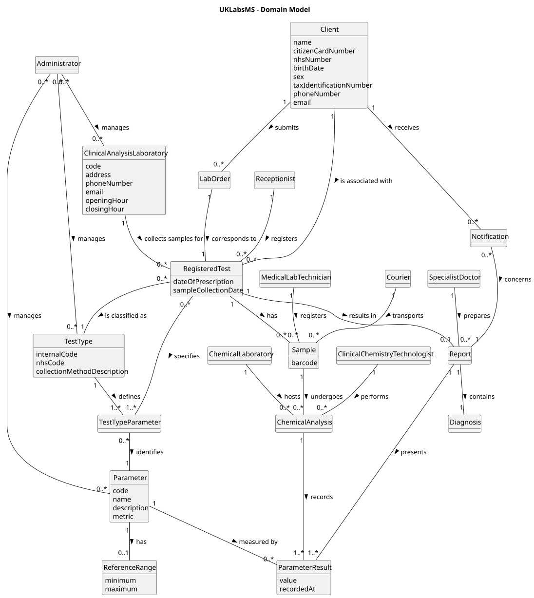

# OO Analysis — UKLabsMS Domain Model

## 1. Purpose and scope

This document explains the identification of conceptual classes and associations in the UK Labs Management System (UKLabsMS) domain model. The Sprint 1 business model, originally based on Section 2.1 (*Business Context*) of the **LETI-ESOFT 2026/2027 Project Assignment**, is refined here with the shared catalog and employee concepts required by Sprint 2 US10-US13. It represents business concepts, not C++ implementation classes, user interfaces, database tables or the chronological order of operations.

The model represents the UK Labs business domain. Where the number of related instances is unrestricted, the model uses an open-ended multiplicity.

## 2. Rationale to identify domain conceptual classes

The following candidates were identified using nouns and noun phrases in the assignment, grouped by conceptual-class categories suggested by *Applying UML and Patterns* (Craig Larman).

| Conceptual class category       | Identified concepts | Rationale |
|:--------------------------------|:---|:---|
| Business transactions / records | `RegisteredTest`, `ChemicalAnalysis` | A test is registered for a client; a chemical analysis is performed and its results recorded. |
| Transaction-related documents   | `LabOrder`, `Report` | The client presents a doctor's prescription; the specialist doctor produces a diagnostic report. |
| Roles of people | `Client`, `Receptionist`, `MedicalLabTechnician`, `ClinicalChemistryTechnologist`, `SpecialistDoctor`, `Administrator`, `Courier` | These represent distinct participants in the laboratory workflow or management of core information. `Courier` participates in physical sample delivery, though software tracking of couriers is not specified. |
| Personnel records and role classification | `Employee`, `Role` | US12 registers personnel with a numeric ID, contact information, and one role; US13 consults the same records by role. The accepted role catalog and its mapping to named professional participants remain to be confirmed. |
| Places                          | `ClinicalAnalysisLaboratory`, `ChemicalLaboratory` | Samples are collected at laboratories across England and analyzed at the central chemical laboratory. |
| Descriptions of services        | `TestType`, `Parameter`, `ReferenceRange` | A test type defines the kind of test; parameters describe what is measured and may have reference limits. |
| Association class               | `TestTypeParameter` | Represents the many-to-many association between a test type and a parameter, and allows a registered test to refer to the parameters specified in its lab order. |
| Physical objects                | `Sample` | Biological samples are collected, associated with registered tests, and identified by barcodes. |
| Records of measured values      | `ParameterResult` | For each measured parameter, a value and analysis date/time are recorded. |
| Clinical conclusions            | `Diagnosis` | A specialist doctor interprets the results and establishes a diagnosis. |
| Communications                  | `Notification` | The client is informed by SMS and/or e-mail once results are available. |

**Conceptual-class distinction:** `TestType` describes a type of examination available in the catalogue; `RegisteredTest` represents a particular prescribed examination registered for an individual client. `TestTypeParameter` associates a test type with one of its measurable parameters and is referenced by a registered test to record the parameters in its lab order. `Parameter` defines what may be measured; `ParameterResult` records the value obtained in an actual analysis.

The Parameter identifier is named `ID` throughout the Sprint 2 model and US11. The earlier `code` label refers to that same identifier, not to a second attribute. `metric` describes the unit or metric, while `metricType` distinguishes Numeric from Qualitative. Reference values apply only to Numeric metrics (AC11-2). Requiring both minimum and maximum and checking their order is the additional US11 rule recorded by the team.

Employee has an automatically generated numeric ID, name, phone number, e-mail address, and one Role. The Doctor Index Number is optional for the general concept and mandatory for a Specialist Doctor, following the US12 requirements. US13 uses the same complete concept even though its consultation output contains only ID, name, and role. The clinical workflow's named professional concepts retain their original responsibilities; no additional Employee inheritance hierarchy or officially accepted role list is inferred.

**Not modeled as conceptual classes:** the user interface, C++ controllers, API calls, and the barcode-generation service. The barcode is represented as an attribute of `Sample`; the external API is an integration relevant to the Use Case Diagram and subsequent design, not necessarily a persistent domain entity.

## 3. Rationale to identify associations

Associations were selected when they describe a meaningful business link between concepts, based on the general association patterns described by Larman (e.g., *contains*, *records*, *describes*, *performs*, or *is associated with*).

| Concept | Association | Concept | Reason |
|:---|:---|:---|:---|
| `Client` | submits | `LabOrder` | A client arrives at a laboratory with a doctor's lab order. |
| `Client` | is associated with | `RegisteredTest` | The receptionist registers the test to be performed for the client. |
| `Receptionist` | registers | `RegisteredTest` | The receptionist records the prescribed test in the application. |
| `LabOrder` | corresponds to | `RegisteredTest` | The test is registered from the lab order presented by the client. |
| `RegisteredTest` | is classified as | `TestType` | The lab order contains the type of test to be performed. |
| `ClinicalAnalysisLaboratory` | is the collection laboratory for | `RegisteredTest` | The collection date and laboratory are associated with the test. |
| `TestType` | defines | `TestTypeParameter` | A test type is characterized by the parameter or parameters it measures. |
| `TestTypeParameter` | identifies | `Parameter` | The association identifies a parameter measured by that test type. |
| `RegisteredTest` | specifies | `TestTypeParameter` | The lab order contains the parameters to be measured for the test. |
| `Parameter` | has | `ReferenceRange` | A parameter may have minimum and maximum reference values. |
| `RegisteredTest` | has | `Sample` | The sample is associated with the client and test. |
| `MedicalLabTechnician` | records | `Sample` | Medical lab technicians collect samples and record them in the system. |
| `Courier` | delivers | `Sample` | Samples are delivered by courier to the chemical laboratory. |
| `Sample` | is analyzed in | `ChemicalAnalysis` | Chemical analyses are performed on samples delivered to the headquarters. |
| `ChemicalLaboratory` | hosts | `ChemicalAnalysis` | Chemical analyses are performed at the central chemical laboratory. |
| `ClinicalChemistryTechnologist` | performs | `ChemicalAnalysis` | The technologist performs chemical analyses and records their results. |
| `ChemicalAnalysis` | records | `ParameterResult` | The technologist records the value and analysis date and time for each parameter. |
| `ParameterResult` | is for | `Parameter` | Each recorded value is for a parameter measured in the analysis. |
| `RegisteredTest` | results in | `Report` | A specialist doctor prepares a report after examining the analysis results. |
| `Report` | contains | `Diagnosis` | The report contains the diagnosis made by the specialist doctor. |
| `Report` | presents | `ParameterResult` | The report makes the analysis results available to the client. |
| `SpecialistDoctor` | prepares | `Report` | The specialist doctor examines the results, makes a diagnosis, and writes a report. |
| `Client` | receives | `Notification` | The client receives a notification when the results are available. |
| `Notification` | concerns | `Report` | The notification informs the client that the results and report are available. |
| `Administrator` | manages | Core catalog information | Administrators manage test types, parameters, laboratories, and employees. |
| `Administrator` | manages and consults | `Employee` | US12 registers employees and US13 lists the same employees by role. The association does not require storing an administrator in every record. |
| `Employee` | is assigned to | `Role` | Each employee has one function/role; a role can be shared by several employees. |

## 4. Multiplicities

- **`Client "1" -- "0..*" LabOrder`**: each lab order belongs to exactly one client. A client may have no lab orders or multiple lab orders.
- **`Client "1" -- "0..*" RegisteredTest`**: each registered test is for exactly one client. A client may have no registered tests or multiple registered tests.
- **`LabOrder "1" -- "1" RegisteredTest`**: each registered test corresponds to exactly one lab order, and each lab order corresponds to exactly one registered test.
- **`RegisteredTest "0..*" -- "1" TestType`**: each registered test has exactly one test type. A test type may be associated with no registered tests or multiple registered tests.
- **`Receptionist "1" -- "0..*" RegisteredTest`**: each registered test is registered by exactly one receptionist. A receptionist may register no tests or multiple tests.
- **`ClinicalAnalysisLaboratory "1" -- "0..*" RegisteredTest`**: each registered test has exactly one sample collection laboratory. A laboratory may be associated with no registered tests or multiple registered tests.
- **`TestType "1" -- "0..*" TestTypeParameter`**: each `TestTypeParameter` belongs to exactly one test type. A test type can have no associations while being configured or several associations once configured. The lower bound of zero is a lifecycle modeling decision allowing US10 and US11 to register entries independently; it is not a new stakeholder acceptance criterion. Before use in a registered test, the definition must cover the prescribed parameters.
- **`TestTypeParameter "0..*" -- "1" Parameter`**: each `TestTypeParameter` identifies exactly one parameter. A parameter may be associated with no test types or with multiple test types.
- **`RegisteredTest "0..*" -- "1..*" TestTypeParameter`**: each registered test specifies one or more `TestTypeParameter` associations. Each association may be specified by no registered tests or by multiple registered tests.
- **`RegisteredTest "1" -- "0..*" Sample`**: each sample belongs to exactly one registered test. A registered test may have no samples or multiple samples.
- **`MedicalLabTechnician "1" -- "0..*" Sample`**: each sample is recorded by exactly one medical lab technician. A technician may record no samples or multiple samples.
- **`Courier "1" -- "0..*" Sample`**: each sample is transported by exactly one courier. A courier may transport no samples or multiple samples.
- **`Sample "1" -- "0..*" ChemicalAnalysis`**: each chemical analysis is performed on exactly one sample. A sample may have no analyses or multiple analyses.
- **`ChemicalLaboratory "1" -- "0..*" ChemicalAnalysis`**: each chemical analysis takes place in exactly one chemical laboratory. A chemical laboratory may host no analyses or multiple analyses.
- **`ClinicalChemistryTechnologist "1" -- "0..*" ChemicalAnalysis`**: each chemical analysis is performed by exactly one technologist. A technologist may perform no analyses or multiple analyses.
- **`ChemicalAnalysis "1" -- "1..*" ParameterResult`**: each parameter result belongs to exactly one chemical analysis. A chemical analysis records one or more parameter results.
- **`Parameter "1" -- "0..*" ParameterResult`**: each parameter result is for exactly one parameter. A parameter may have no results or multiple results.
- **`RegisteredTest "1" -- "0..1" Report`**: each report is for exactly one registered test. A registered test may have no report yet or one report.
- **`Report "1" -- "1" Diagnosis`**: each report contains exactly one diagnosis, and each diagnosis belongs to exactly one report.
- **`Report "0..1" -- "1..*" ParameterResult`**: a parameter result may await report preparation or be presented in one report. A report presents one or more results. The optional report end models the results-before-report lifecycle; it does not change the rule that clients must await the report before accessing results.
- **`SpecialistDoctor "1" -- "0..*" Report`**: each report is prepared by exactly one specialist doctor. A specialist doctor may prepare no reports or multiple reports.
- **`Client "1" -- "0..*" Notification`**: each notification is received by exactly one client. A client may receive no notifications or multiple notifications.
- **`Notification "0..*" -- "1" Report`**: each notification concerns exactly one report. A report may be associated with no notifications or multiple notifications.
- **`Parameter "1" -- "0..1" ReferenceRange`**: each reference range belongs to exactly one parameter. The general concept permits no range or one range; US11's additional rule requires one range for Numeric metrics and none for Qualitative metrics.
- **`Administrator "0..*" -- "0..*" TestType`**: an administrator may manage no test types or multiple test types. A test type may be managed by no administrators or multiple administrators.
- **`Administrator "0..*" -- "0..*" Parameter`**: an administrator may manage no parameters or multiple parameters. A parameter may be managed by no administrators or multiple administrators.
- **`Administrator "0..*" -- "0..*" ClinicalAnalysisLaboratory`**: an administrator may manage no laboratories or multiple laboratories. A laboratory may be managed by no administrators or multiple administrators.
- **`Administrator "0..*" -- "0..*" Employee`**: administrators manage and consult employee records. This represents responsibility, not ownership or a requirement for registrar history.
- **`Employee "0..*" -- "1" Role`**: each employee has exactly one assigned role. A role can be assigned to no employees or multiple employees.

The multiplicities describe the number of instances at each end of an association; `0..*` means none or any number, `0..1` means optional, and `1..*` means one or more.

### Business rule not expressed by a class association alone

Clients must only be allowed to access analysis results once the specialist doctor has prepared the report. This temporal/access rule belongs in requirements documentation and the associated use-case behavior, rather than being inferred from an association alone.

Likewise, the derived rule that a Test Type used in a Registered Test must cover its prescribed parameters is a condition of use, not a prerequisite for standalone Test Type or Parameter registration. The TestTypeParameter configuration workflow is not implemented by US10 or US11.

The TestTypeParameter associations selected for a RegisteredTest must belong to that RegisteredTest's TestType. This is a derived consistency constraint linking the shared catalog to the prescribed test, rather than a new official acceptance criterion for US10 or US11.

## 5. Domain Model

The diagram is generated from `puml/DM.puml`. Both the source and exported SVG must be committed to the repository.

The domain model records intended business relationships, not proof that they have been implemented. [The integration overview](../README.md) records the actual source status: US12 registration is not implemented, the US13 employee API currently fails syntax checks, and TestTypeParameter configuration remains pending.

## 6. References

- LETI-ESOFT 2026/2027 — Project Assignment, Section 2.1 (*Business Context*).
- Craig Larman, *Applying UML and Patterns*, conceptual-class categories and common-association patterns.
- [US10 - Register a Test Type](../US10/US10.md).
- [US11 - Register a Parameter](../US11/US11.md).
- [US12 - Register an Employee](../US12/US12.md).
- [US13 - List Employees by Role](../US13/US13.md).
