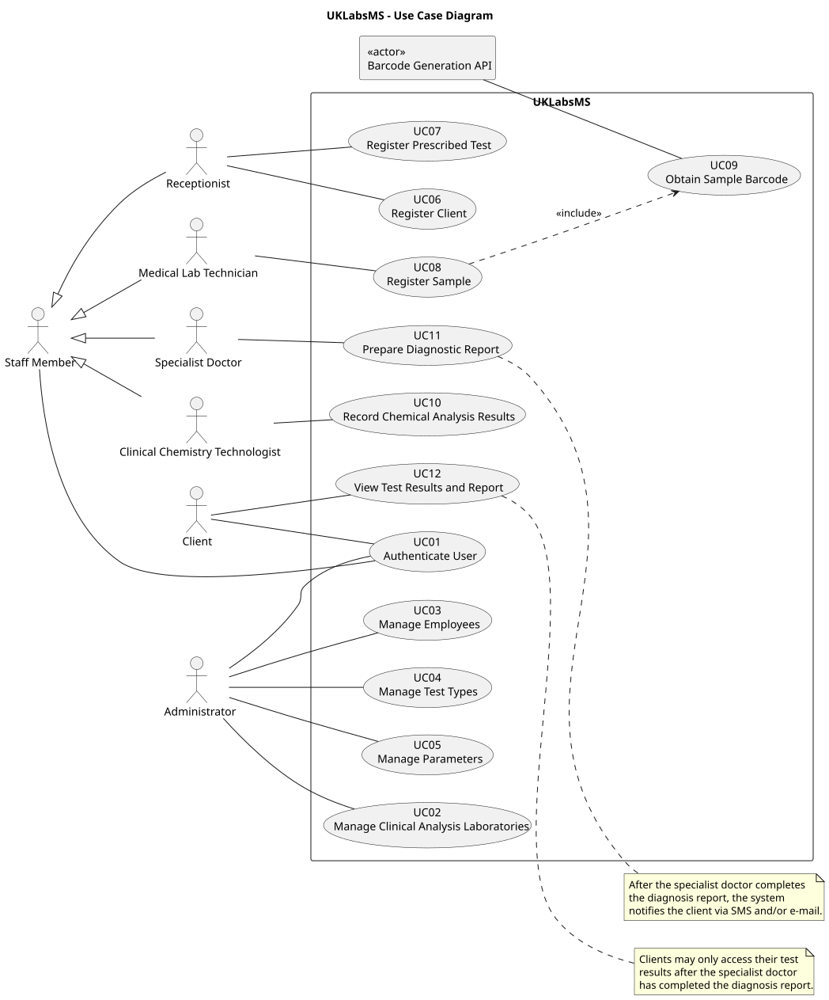

# Use Case Diagram (UCD)

## 1. Introduction

This document presents the Use Case Diagram of the UK Labs Management System (UKLabsMS), developed during Sprint 1 of the LETI-ESOFT 2026/2027 project.

The diagram identifies the main system actors, functional requirements, and interactions derived from the UK Labs Project Assignment.

The use cases represent the system's initial functional scope and may be refined in subsequent sprints.

## 2. Use Case Diagram

## 3. Actors

| Actor                           | Description |
|:--------------------------------|:---|
| Staff Member                    | Generalized actor representing operational UK Labs staff who interact with the system. |
| Administrator                   | Separate actor who manages the core information necessary for the system's operation. |
| Receptionist                    | Registers clients and prescribed clinical tests. |
| Medical Lab Technician          | Collects biological samples and records them in the system. |
| Clinical Chemistry Technologist | Performs chemical analyses and records the obtained results. |
| Specialist Doctor               | Reviews analysis results, establishes diagnoses, and prepares diagnostic reports. |
| Client                          | Consults clinical analysis results and diagnostic reports after they become available. |
| Barcode Generation API          | External system responsible for automatically generating barcodes for collected samples. |
## 4. Use Cases / User Stories

| UC/US       | Description                           |
|:------------|:--------------------------------------|
| UC01 / US01 | Authenticate User                     |
| UC02 / US02 | Manage Clinical Analysis Laboratories |
| UC03 / US03 | Manage Employees                      |
| UC04 / US04 | Manage Test Types                     |
| UC05 / US05 | Manage Parameters                     |
| UC06 / US06 | Register Client                       |
| UC07 / US07 | Register Prescribed Test              |
| UC08 / US08 | Register Sample                       |
| UC09 / US09 | Obtain Sample Barcode                 |
| UC10 / US10 | Record Chemical Analysis Results      |
| UC11 / US11 | Prepare Diagnostic Report             |
| UC12 / US12 | View Test Results and Report          |

## 5. Use Case Relationships

### Actor Generalization

The Receptionist, Medical Lab Technician, Clinical Chemistry
Technologist, and Specialist Doctor are specializations of the
Staff Member actor. The Administrator is a separate actor, not a
Staff Member, and authenticates independently.

This generalization represents their shared role as
UK Labs employees while preserving their specific
responsibilities.

### Include Relationship

UC08 (Register Sample) includes UC09
(Obtain Sample Barcode).

Every collected sample must be identified using a barcode
automatically generated through an external API.

### Authentication

Authentication is a prerequisite for accessing the system.

The authentication mechanism may be simulated during
the prototype development stage, as specified in the
Project Assignment.

## 6. Business Rules

| ID | Business Rule |
|:---|:---|
| BR01 | Only a subset of UK Labs clinical analysis laboratories performs COVID-19 tests. |
| BR02 | Each registered test is associated with a client, a test type, the prescribed parameters, a prescription date, a sample collection date, and a collection laboratory. |
| BR03 | Every collected sample is associated with a registered test and identified by an automatically generated barcode. |
| BR04 | Chemical analysis results include the obtained value and the analysis date and time for each measured parameter. |
| BR05 | Clients may access their analysis results only after a specialist doctor has prepared the diagnostic report. |
| BR06 | After the specialist doctor completes the diagnosis and report, the system sends an SMS and/or email notification informing the client that the results are available. |

## 7. Modeling Decisions and Assumptions

- The use cases are organized by functional responsibility.
- The distinction between test types and registered tests is preserved.
- The Barcode Generation API is modeled as an external system because the Project Assignment explicitly requires this integration.
- Authentication is represented as a general system function rather than included in every individual use case.
- Client notification is modeled as an automatic system behavior following the completion of the diagnostic report (UC11), rather than as a separate use case.
- UC12 represents the client's ability to view test results and the diagnostic report once they become available.
- UC01 to UC12 are identifiers proposed by the team for requirements organization and traceability.

## 8. References

- LETI-ESOFT 2026/2027 - Project Assignment.
- LETI-ESOFT 2026/2027 - Project Sprint 1.
- UKLabsMS Project Glossary.
